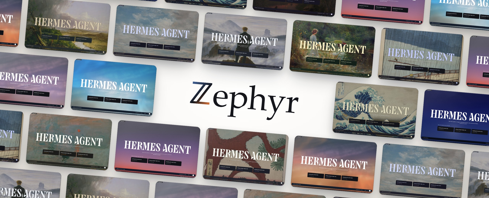
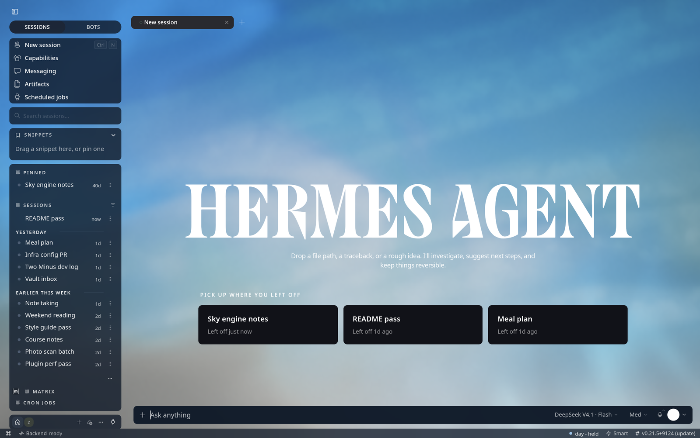
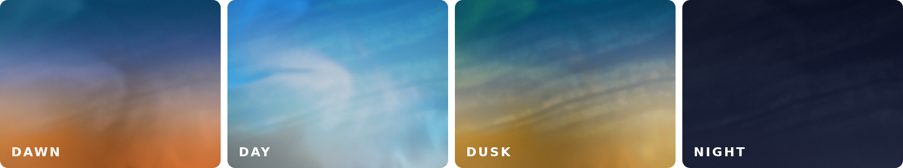
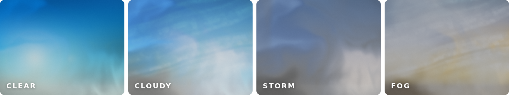
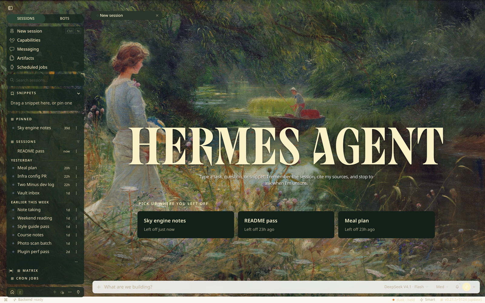
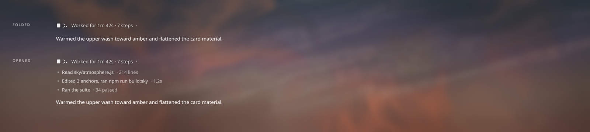
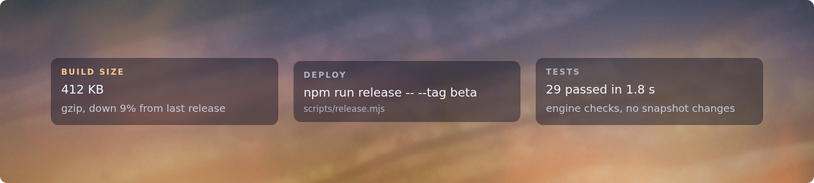

<p align="center">
  
</p>

# 

A better UI for the Hermes Agent desktop app: better backgrounds, a live sky behind the app, and more refined UI everywhere.

<p align="center">
  
</p>

## Background

Zephyr gives Hermes a background and then makes every surface work with it: panels take a tint from what is behind them and get denser where the light is bright, so prose keeps its contrast.

### Sky theme

A live sky over your window, from your own clock and weather.

- **Real sun.** Sunrise, sunset, twilight and night come from a city in your time zone, so evenings are late in June and early in December.
- **Live weather.** Cloud, rain and fog follow [Open-Meteo](https://open-meteo.com). No account, no key, no location prompt.
- **Nine sky types** to hold one instead: clear, fair, partly, cloudy, cirrus, overcast, rain, storm, fog. A change cross-fades over 25 seconds.
- **Blended, never stepped.** Hourly anchors are interpolated, so dusk arrives gradually instead of in jumps.
- **A real shader.** WebGL draws a soft, defocused cloud field. No WebGL, or Realistic sky off, and a painted gradient takes over.
- **Light that moves.** Panels and accent follow the sun: cool blue at noon, amber at dusk.

<p align="center">
  
  
</p>

The status-bar picker shows your current look, such as “Sky · Live” or “Aurora”. Open it to choose a look or hold a time of day.

### Gruvbox theme

*The Backwater* (C. W. Wyllie, 1903) behind tinted glass, dressed from gruvbox's own element table: cream text, green glass, amber accent.

<p align="center">
  
</p>

**Custom** is the same machinery with your own picture: `zephyr-theme.json`, created by Settings > Zephyr > Theme file, holds every colour, opacity and filter, and a save applies in two seconds.

## Interface

- **Floating sidebar.** Cmd/Ctrl+S, or the top-left button, morphs it between pinned and floating: floating tucks away and slides in when you touch the left edge. That morph is a view transition, so the column and the chat glide as one piece.
- **Tabs** are wide pills. Cmd/Ctrl+Option+Left/Right walks them (a rebindable keybind), a session opens in the tab you are in, and an empty tab shows the wordmark, not a blank page.
- **Folded work.** When a reply finishes, its thinking and tool steps fold into one line with the time it took. Click the line to open them again; the fold fades, it never fights the layout.
- **Animations**: menus, selects, popovers, dialogs and tooltips (6px, in from the side they open on), exit ghosts, the history list, the composer, tool rows, and one fade as a session swaps in. 140–280ms, opacity and transform only, so the compositor owns them. Off, or with reduced motion, everything is instant.
- **Status panel** moves the status bar into the sessions sidebar in Simple mode.
- **Spacious margins** hold the reading column to 46rem, lined up with the message box, with a typographic pass on the prose itself.
- **Reply legibility.** Assistant replies get a soft, unframed fill when their backdrop needs more contrast. Its colour follows the current material, and its strength follows the rendered sky or sampled picture. Already-readable replies keep their original appearance, including night skies. Code and tool cards keep one ground inside the reply.

<p align="center">
  
</p>

## Snippets and the shelf

An agent can answer with a card instead of a paragraph. You can keep it.

```
::snippet{title="Build size" value="412 KB" note="gzip, down 9%" source="npm run size"}
```

`value` is the only required field; `title`, `note`, `source` and `tone="accent"` are optional. Click a card to preview it, copy it, or attach it to the chat. **Pin** one and it joins the Snippets card in the sidebar; drag it, or a status row, onto the shelf above the new-chat wordmark.

<p align="center">
  
</p>

## New tabs that suggest

An empty tab offers where to go next, and says why each card is there. **Pick up where you left off** shows the sessions you have worked on lately, ranked by recency and by how much you wrote.

It learns only from when you open sessions and send messages, keeps a small record per session on your computer, never shuffles while you look, and leaves out pinned sessions and quick chats (six messages or fewer, three of yours, never returned to on another day). Turn it off in Settings > Zephyr > Chat.

## Install

1. Download `plugin.js` from this repository.
2. Put it in `<HERMES_HOME>/desktop-plugins/zephyr/`.
3. For Gruvbox, put `assets/backwater.jpg` beside it. Cloning the repo there works too.
4. Restart Hermes. Zephyr appears in Settings with its own icon.

Delete the folder and restart to remove.

## Settings

Choose **Sky**, **Aurora**, **Gruvbox**, or **Custom** in the appearance gallery under **Settings > Plugins > Zephyr**. Sky can follow the sun or hold Dawn, Sunrise, Day, Sunset, or Night. Aurora holds night, with clear weather by default. Weather choices are remembered separately for each look, and switching to Aurora preserves your Sky time selection.

**Background** hides the scenery while keeping the look’s colours; **Zephyr styling** controls glass, panels and typography. **Fine-tune appearance** contains rendering, smoothness, preview and accent controls. Custom exposes its picture and glass editor. **Use Hermes appearance** restores the last Hermes theme and pauses Zephyr appearance while keeping chat settings and snippets active.

Hermes Appearance contains one stable **Zephyr** entry; the selection stays the same as the sky changes. Suggestion cards, spacious margins, motion, the status panel, snippets and pins remain in Zephyr’s settings.

**Reply legibility**, under Chat, is on by default and remembered. Turning it off removes the reply fill and all its nested-surface adjustments. It also checks Hermes appearance and light themes against their native text and ground; it leaves passing pairs alone. Arbitrary host background images are not sampled. The contrast model, decisions, measured cases and remaining verification limits are in [the implementation report](docs/reply-legibility.md).

## Performance

The sky caches its cloud field in a texture and re-renders it a few times a minute: 8 fps by default, 1 when the window is unfocused, nothing when it is hidden, plus a few pixels of blur so text stays readable. Reduced motion is respected. If it runs warm, set Smoothness to Low.

Reply legibility reads the sky’s retained image on the existing material refresh, rather than adding work to sky frames. Pictures are decoded when they load; later checks reuse that small image sample. It adds no timer, message observer or live backdrop blur; the occasional image readback has a measurable refresh cost, documented in the report.

## Privacy

No location prompt: Zephyr reads a nearby city from your time zone, then asks Open-Meteo for sunrise, sunset and weather. Nothing else leaves your computer, and the suggestions stay on disk.

## For developers

- `plugin.js` is one plain ES module in numbered sections (§1–§9); search `══ §6` to jump. Imports are limited to `@hermes/plugin-sdk` and `react`.
- The sky is generated: edit `sky/`, run `npm run build:sky`, commit both. The session rules are `recents/engine.js`, baked in by `npm run build:recents`. The atmosphere table comes from `scripts/bake-atmosphere.mjs` and `docs/rebuild-specification.md`.
- Before a pull request: `npm test`, `npm run check`, `npm run rig`, then try it in the app.

## Credits

The idea came from [hark.com](https://hark.com); Zephyr's sky is an independent build from a written description, no borrowed code. Weather from [Open-Meteo](https://open-meteo.com). *The Backwater* is by Charles William Wyllie (1859–1923), public domain, scanned full size.

MIT licensed. The Hark name belongs to its owners.
