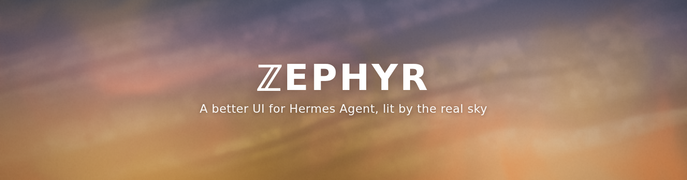
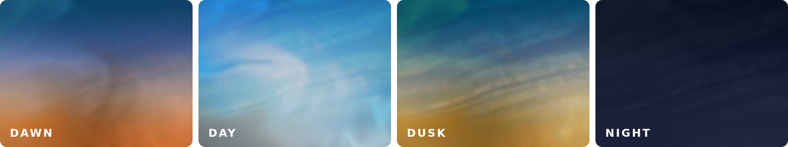
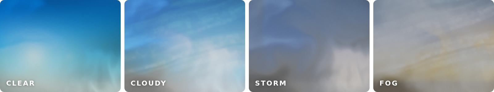
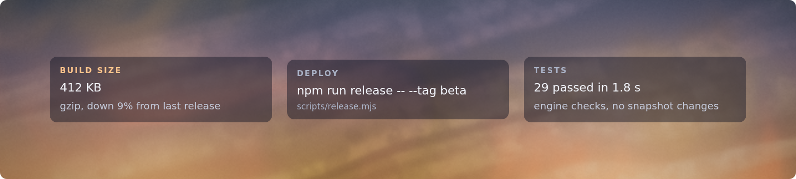

<p align="center">
  
</p>

# Zephyr

A better UI for Hermes Agent, lit by the real sky.

Zephyr is a plugin for the Hermes Agent desktop app. It puts a live, realistic sky behind the app and changes the app's colours as the day goes by. It also adds a few small things that make chatting with your agent calmer: snippet cards you can save, a tidier status bar and roomier margins.

It's one JavaScript file. There's no build step, and it doesn't modify Hermes itself, so updating the app won't undo it.

<p align="center">
  
</p>

## Features

**A sky that follows the real sun.** The background shows the sky where you are, right now. The sun rises and sets on time, twilight brings its own colours, and night goes dark.

**Live weather.** Clouds follow your local weather. If you prefer one look, you can hold the sky on a fixed type: clear, cumulus, cirrus, overcast, rain, storm, fog and more.

<p align="center">
  
</p>

**Time-of-day themes.** Pick Zephyr Sky in Appearance and Hermes's colours follow the sun through dawn, day, dusk and night. The readout in the status bar ("dynamic - 2:45 PM") is a button too: each click holds the next sky (Dawn, Sunrise, Day, Dusk, Night), then goes back to following the sun. Zephyr Dawn, Day, Dusk and Night each hold one sky. Picking any other theme in Appearance (Nous, Solarized and the rest) switches Zephyr off completely, with no sky, no painting and no theme requests, until you pick a Zephyr theme again. The accent colour (links, buttons, selection) can shift too.

**Glass panels.** The panels pick up a soft tint from the sky behind them, and they go darker at night so text stays easy to read.

**Snippet cards.** Your agent can show short facts as clean cards in the chat, for example a build size, a command or a time. You can copy a card, pin it to your library, or drag it onto the Shelf on the new-chat screen.

**Calmer chat.**
- Spacious margins: a narrower reading column that lines up with the message box.
- Fold finished work: when a reply is done, its thinking and tool steps fold into one line that shows how long it took.
- Status panel: in Simple mode, the status bar (model, context, agents, radio) becomes a card in the sessions sidebar. Drag a status row onto the panel title to pin it.
- Tab keys: Cmd+Option+Left/Right moves between tabs, and a collapsed pane drops its labels instead of stacking them letter by letter.

## Install

1. Download `plugin.js` from this repository.
2. Create a folder named `zephyr` inside your Hermes plugins folder:
   ```
   <HERMES_HOME>/desktop-plugins/zephyr/
   ```
3. Put `plugin.js` in that folder. For the Backwater look, also put `assets/backwater.jpg` there (either next to `plugin.js` or in an `assets/` folder). Cloning the whole repository into that folder works too.
4. Restart Hermes Agent. Zephyr appears in Settings with its own icon.

To remove Zephyr, delete the `zephyr` folder and restart Hermes.

## Settings

Open **Settings > Zephyr**.

| Setting | What it does |
| --- | --- |
| Sky | Shows the sky behind the app. Off gives a plain dark background. |
| Realistic sky | Uses the full WebGL sky. Off, or on a device without WebGL, you get a lighter painted gradient. |
| Weather | Live weather, or one fixed sky type. |
| Smoothness | Low, Balanced or High (4, 8 or 16 frames a second). Clouds drift slowly, so Balanced looks the same as High and uses half the power. |
| Preview a day | Plays the next 24 hours of sky in one minute, then goes back to now. |
| Time-of-day themes | Keeps Hermes on Zephyr Sky, whose colours move with the sun. Off keeps the theme you picked in Appearance. |
| Tint the accent | Shifts the accent colour to match the time of day. |
| Spacious margins | A narrower reading column with wide margins. |
| Fold finished work | Folds finished replies' steps into one line. |
| App animations | Short fades and slides on menus, the history list, the composer and folded steps. Off makes every interaction instant. Follows your system's reduced-motion setting. |
| Status panel in Simple mode | Moves the status bar into the sessions sidebar. |
| Snippet library | Shows the Snippets card in the sidebar with everything you've pinned. |
| Background | **Sky** (the live sky), **Built-in** (The Backwater, a painting behind green glass) or **Custom** (your own picture and colours). |

## Looks

Zephyr has two kinds of look, and you can switch between them either in **Settings > Zephyr > Background** or in **Settings > Appearance > Theme**:

- **Zephyr Sky**: the live sky. It follows the real sun all day, and Hermes's colours move with it through dawn, day, dusk and night while the theme stays selected.
- **Zephyr Dawn, Day, Dusk, Night**: hold one sky, whatever the time.
- **Zephyr Gruvbox**: a painting, The Backwater, behind tinted glass, with gruvbox cream text.
- **Custom**: your own picture and colours, from the controls in Settings or from `zephyr-theme.json` (below).

### Your own look: `zephyr-theme.json`

The Custom look lives in one file, `<HERMES_HOME>/zephyr-theme.json`. **Settings > Zephyr > Theme file** creates it and shows it in Finder. Edit it in any editor and Hermes follows within two seconds; moving a control in Settings writes it back. Every key is optional, and a missing key keeps its default.

```json
{
  "image": "~/Pictures/my-wallpaper.jpg",
  "fit": "cover",
  "posX": 46,
  "posY": 45,
  "scrim": 0.31,
  "blur": 18,
  "saturate": 1.3,
  "brightness": 0.9,
  "chrome": 0.74,
  "sidebar": 0.74,
  "card": 0.78,
  "bubble": 0.78,
  "ground": "#16261e",
  "deeper": "#0c1612",
  "cardTint": "#1d3328",
  "bubbleTint": "#2b4636",
  "edge": "#4f7360",
  "accent": "#fe8019",
  "ink": "#fbf1c7",
  "ink2": "#ebdbb2"
}
```

| Key | What it controls |
| --- | --- |
| `image` | The picture: a path (`~/…` works), a URL, or `"uploaded"` for one picked in Settings. |
| `fit`, `posX`, `posY` | `cover` or `contain`, and which part of the picture stays in view (percent). |
| `scrim` | How much the picture is darkened behind everything. |
| `blur`, `saturate`, `brightness` | The frosted glass behind the chat. |
| `chrome`, `sidebar`, `card`, `bubble` | How solid the chat pane, the pinned sidebar, cards and your messages are (0 to 1). |
| `ground`, `deeper` | The glass colours: the chat, and the sidebar and darkest surfaces. |
| `cardTint`, `bubbleTint` | Cards and the message box; your messages and tabs. |
| `edge` | Hairlines, borders and the text selection. |
| `accent` | Buttons and toggles. Never used for text. |
| `ink`, `ink2` | Text, and quieter text. |

## Sidebar

**Ctrl+S** on Windows, **Cmd+S** on macOS, switches the sidebar between two modes, with a short morph between them. The button at the top left of the sidebar does the same.

- **Pinned**: the sidebar sits in the window as it always has.
- **Floating**: the sidebar stays out of the way until you touch the left edge of the window. It slides in over the chat and tucks away when you move off it, or on Escape.

## Tabs

- Tabs are wide pills. The close button shows on the active tab and on hover.
- **Ctrl/Cmd+Option+Left/Right** walks the session tabs. It is a contributed keybind, so it can be rebound in Settings > Keybinds.
- A new tab shows the Hermes wordmark instead of an empty page.
- Clicking a session in the sidebar opens it in the tab you are in, instead of adding one.
## Snippet cards

<p align="center">
  
</p>

An agent shows a snippet card by writing a line like this in its reply:

```
::snippet{title="Build size" value="412 KB" note="gzip, down 9% from last release"}
```

| Field | Required | Meaning |
| --- | --- | --- |
| `value` | Yes | The main text, shown large. |
| `title` | No | A small label above the value. |
| `note` | No | A short line of extra context. |
| `source` | No | Where the value came from, shown small. |
| `tone` | No | Set to `accent` to colour the title with the accent colour. |

Click a card to preview it. From the preview you can copy it or attach it to the chat.

## Performance

The sky is built to stay light:

- It draws at 8 frames a second by default.
- It drops to 1 frame a second when the window isn't focused, and stops when the window is hidden.
- It respects your system's reduced-motion setting.

If your machine still runs warm, set **Smoothness** to Low or turn off **Realistic sky**.

## Privacy

Zephyr doesn't ask for your location. It works out a nearby city from your system time zone, then gets sunrise, sunset and current weather from [Open-Meteo](https://open-meteo.com), a free weather service that needs no account or key. Nothing else leaves your computer.

## For developers

- Everything lives in `plugin.js`, a plain ES module. The Hermes loader reads only that file and allows imports from `@hermes/plugin-sdk` and `react` only.
- The file is split into numbered sections (`§1` to `§9`). The contents list at the top says what each one covers. Search for `══ §6` to jump to a section.
- The sky section (§6) is generated from `sky/`. Edit those files, run `npm run build:sky`, and commit both.
- Before you open a pull request, run `npm test`, `npm run check` and `npm run rig`, then try the change in the app.

## Where the sky comes from

Zephyr's sky is heavily inspired by, and designed after, the sky on [hark.com](https://hark.com). I'm grateful I came across that idea, because it's what started this project.

No code from hark.com is borrowed or used here. Zephyr's sky was reimplemented independently, from a written description of how the original behaves.

## Credits

Weather and sunrise data come from [Open-Meteo](https://open-meteo.com).

The Backwater is by Charles William Wyllie (1859–1923), exhibited at the Royal Academy in 1903, and is in the public domain. `assets/backwater.jpg` is a full-resolution scan.

## License

Zephyr is released under the [MIT License](LICENSE). The Hark name and the hark.com sky belong to their owners.
