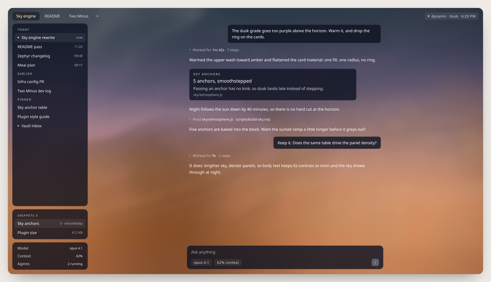
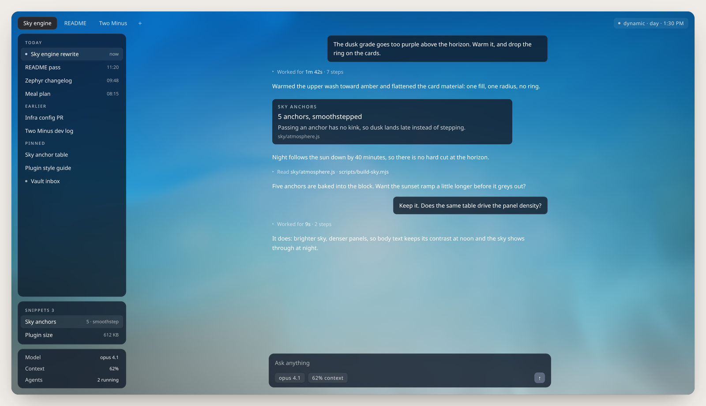

<p align="center">
  
</p>

# Zephyr

A better UI for the Hermes Agent desktop app: a live sky behind the app, light that follows the clock, and quieter chrome down to the last animation.

One JavaScript file. No build step, no fork, so a Hermes update can't undo it.

<p align="center">
  
</p>

## The sky

Zephyr paints the sky over your window, right now, from your clock and weather.

- **Real sun.** Sunrise, sunset, twilight and night come from a city in your time zone, so evenings are late in June and early in December.
- **Live weather.** Cloud, rain and fog follow [Open-Meteo](https://open-meteo.com). No account, no key, no location prompt.
- **Nine sky types** to hold one instead: clear, fair, partly, cloudy, cirrus, overcast, rain, storm, fog. A change cross-fades over 25 seconds.
- **Blended, never stepped.** Hourly anchors are interpolated, so dusk arrives gradually instead of in jumps.
- **A real shader.** WebGL draws the sky with a soft, defocused cloud field. No WebGL, or Realistic sky off, and a painted gradient takes over.

<p align="center">
  
  
</p>

## Light

Hermes's colours move with the sun. Panels get denser as the sky brightens, so prose keeps its contrast at noon and the sky shows through at night. The accent shifts with the phase too: cool blue at midday, amber at dusk.

- **Zephyr Sky** follows the sun. **Zephyr Dawn, Day, Dusk, Night** hold one sky.
- **Zephyr Gruvbox** is a painting, *The Backwater* (C. W. Wyllie, 1903), behind tinted glass with gruvbox cream text.
- **Custom**: your picture and glass, every colour and opacity in a `zephyr-theme.json` that Settings > Zephyr > Theme file creates; a save applies in two seconds.

The readout in the status bar ("dynamic · 2:45 PM") is a button: each click holds the next sky, then hands back to the clock. Picking any other theme in Appearance switches Zephyr off.

<p align="center">
  
</p>

## Chrome and motion

Two switches keep the look independent of the background: **Background** (sky, built-in, custom) and **Zephyr styling** (glass, sidebar, cards, type).

- **Floating sidebar.** Cmd/Ctrl+S, or the top-left button, morphs it between pinned and floating: floating tucks away and slides in when you touch the left edge. That morph is a view transition, so the column and the chat glide as one piece.
- **Tabs** are wide pills. Cmd/Ctrl+Option+Left/Right walks them (a rebindable keybind), a session opens in the tab you are in, and an empty tab shows the wordmark, not a blank page.
- **Folded work.** When a reply finishes, its thinking and tool steps fold into one line with the time it took. The fold fades; it never fights the layout.
- **Status panel** moves the status bar into the sessions sidebar in Simple mode.
- **Animations**: menus, selects, popovers, dialogs and tooltips (6px, in from the side they open on), exit ghosts, the history list, the composer, tool rows, and one fade when a session swaps in. 140–280ms, opacity and transform only, so the compositor owns them. Off, or with reduced motion, everything is instant.
- **Spacious margins** hold the reading column to 46rem, lined up with the message box, with a typographic pass on the prose itself.

## Snippets and the shelf

An agent can answer with a card instead of a paragraph. You can keep it.

```
::snippet{title="Build size" value="412 KB" note="gzip, down 9%" source="npm run size"}
```

`value` is the only required field; `title`, `note`, `source` and `tone="accent"` are optional. Click a card to preview it, copy it, or attach it to the chat. **Pin** one and it joins the Snippets card in the sidebar; drag it, or a status row, onto the shelf above the new-chat wordmark to keep it in front of you.

## New tabs that suggest

An empty tab offers where to go next, and says why each card is there:

- **Pick up where you left off**: the sessions you have worked on lately, ranked by recency and by how much you actually wrote.
- **Your regulars**: sessions you keep returning to, once you have opened one on three different days ("Usually every ~14 days, last 12 days ago").

It learns only from when you open sessions and send messages, keeps a small record per session on your computer, never shuffles while you look, and leaves out pinned sessions and quick chats (six messages or fewer, three of yours, never returned to on another day). Turn it off in Settings > Zephyr > Chat.

## Install

1. Download `plugin.js` from this repository.
2. Put it in `<HERMES_HOME>/desktop-plugins/zephyr/`.
3. For the Gruvbox look, put `assets/backwater.jpg` beside it. Cloning the repo there works too.
4. Restart Hermes. Zephyr appears in Settings with its own icon.

Delete the folder and restart to remove.

## Settings

Everything is in **Settings > Zephyr**: Background, Sky, Zephyr styling, Realistic sky, Weather, Smoothness (4, 8 or 16 fps; Balanced looks like High at half the power), Preview a day, Time-of-day themes, Tint the accent, Suggest sessions, Suggestion card material (matte or glass), Spacious margins, Fold finished work, App animations, Status panel, Snippet library and the pin roster.

## Performance

The sky caches its cloud field in a texture and re-renders it a few times a minute: 8 fps by default, 1 when the window is unfocused, nothing when it is hidden, plus a few pixels of blur so text stays readable. Reduced motion is respected. If it runs warm, set Smoothness to Low.

## Privacy

No location prompt: Zephyr reads a nearby city from your time zone, then asks Open-Meteo for sunrise, sunset and weather. Nothing else leaves your computer, and the suggestions stay on disk.

## For developers

- `plugin.js` is one plain ES module in numbered sections (§1–§9); search `══ §6` to jump. Imports are limited to `@hermes/plugin-sdk` and `react`.
- The sky is generated: edit `sky/`, run `npm run build:sky`, commit both. The session rules are `recents/engine.js`, baked in by `npm run build:recents`. The atmosphere table comes from `scripts/bake-atmosphere.mjs` and `docs/rebuild-specification.md`.
- Before a pull request: `npm test`, `npm run check`, `npm run rig`, then try it in the app.

## Credits

The idea came from [hark.com](https://hark.com); Zephyr's sky is an independent build from a written description, no borrowed code. Weather from [Open-Meteo](https://open-meteo.com). *The Backwater* is by Charles William Wyllie (1859–1923), public domain, scanned full size.

MIT licensed. The Hark name belongs to its owners.
