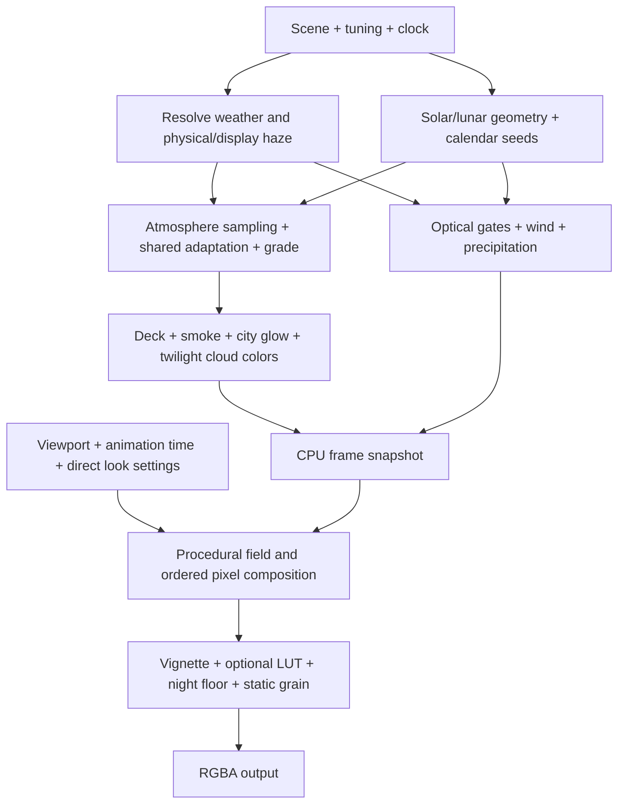

# Dynamic sky simulation: independent rebuild specification

Version 1.0 · 15 October 2026

This specification describes the behavior of the supplied Hark sky module and its Hermes/Zephyr desktop adapter. It is intended to let a separate implementation reproduce the simulation without receiving the original program. It includes equations, parameter values, stage ordering, interfaces, observed numerical outputs, and compatibility traps. It does not reproduce the original shader, atmospheric table payload, or optional color-grade texture.

The reference was inspected in full and its CPU calculations were evaluated with frozen clocks. No rendered reference image or surrounding renderer was supplied. Statements about appearance below are derived from the executable math; numerical fixtures are actual reference outputs. Where executable behavior disagrees with comments, the executable behavior is specified.

Companion deliverable: `sky-rebuild-reference-fixtures.json`. It contains independent fresh-state cases, complete frame parameters, selected graded palette samples, and aspect-ratio examples. See §23 for the test contract and its limits.

## Contents

1. Product and visual contract
2. Architecture and ownership
3. Notation and color conventions
4. Scene, defaults, and parameter inventory
5. Clock, calendar, and location
6. Solar and lunar geometry
7. Effective weather, cloud cover, and aerosol
8. Deterministic variation
9. Atmospheric palette data
10. Palette grading
11. Cloud deck and weather composition
12. Glow, tint, and twilight cloud phases
13. Optical phenomena: CPU gates
14. Wind and precipitation parameters
15. Frame and GPU interface
16. Projection and aspect-ratio behavior
17. Noise and procedural cloud field
18. Pixel composition, in exact order
19. Animation and integration
20. Public interface behavior
21. Compatibility traps and absent features
22. Independent implementation plan
23. Verification and acceptance
24. Open dependencies and source map

## 1. Product and visual contract

### 1.1 What is being rebuilt

The output is an animated, full-window, two-dimensional sky backdrop. It behaves like an art-directed sky photograph in slow motion. A four-color vertical atmospheric gradient is continuously distorted and illuminated by procedural fields. It is rendered using a single full-screen triangle and one fragment-shading pass.

There is no cube map, spherical sky mesh, movable camera, physical cloud volume, ray-marching integrator, terrain, or horizon silhouette in this module. Geographic position influences celestial calculations, not the camera's compass bearing. The sun's vertical position uses astronomical altitude; its horizontal position is a designed left-to-right sweep.

The essential visual relationships are:

- Daylight has a saturated blue upper sky, a lighter lower sky, soft moving cloud structure, and a compact luminous sun region.
- Clear air supports a deepened blue arc approximately 90° from the sun and a brighter, less saturated region near it.
- Haze broadens and whitens illumination but is deliberately compressed to keep ordinary skies attractive. Ordinary AQI must not make the sky muddy brown.
- Scattered/broken conditions introduce long, feathered cirrus-like strands. Increasing cover may build a bright cool lid, but sunny weather codes limit how completely the lid can close.
- A low sun grows softer and larger, warms cloud material, and physically descends below the lower edge.
- Twilight has a gray cloud interval, followed by a rose re-illumination interval. The warm gradient also compresses downward.
- Some months permit an extra purple twilight lobe with shadow fans. The effect can be completely absent in other months.
- Night retains dim blue cloud texture, a location-dependent amber lower-sky glow, a moon only when it is geometrically up, and a final dark-blue display floor.
- Fog has irregular banks. Rain, snow, and hail categories produce distant precipitation curtains rather than individually simulated drops or flakes.
- Motion is slow and coherent. Grain is stationary in pixel space; it must not sparkle frame to frame.

### 1.2 Fidelity priorities

In descending order: palette and day/night progression; scale and gradient geometry; cloud-field softness and motion; sun/moon position and compact bloom; cloud regime changes; twilight timing; optical phenomena; final grain and vignette.

Do not substitute a generic blue-to-orange time-of-day gradient and expect a faithful result. The atmospheric table, shared exposure adaptation, nonlinear grading, and ordered weather transforms collectively determine the look.

### 1.3 Scope of the desktop version

The desktop adapter supplies a fixed Toronto scene and follows a clock. It does not fetch weather, geolocate, persist settings, create a window/canvas, schedule frames, compile shaders, manage graphics resources, or provide controls. Weather can be changed programmatically. Features inherited from the larger original application are available through mutable state but have no associated UI here.

## 2. Architecture and ownership

Use three conceptual layers, regardless of language or graphics API:

| Layer | Inputs | Responsibilities | Outputs |
|---|---|---|---|
| Scene/clock adapter | Partial scene updates, wall clock, machine time zone | Store scene, resolve local time/date, apply grade multipliers | Effective simulation state |
| CPU frame evaluator | Effective state and celestial time | Celestial geometry, atmosphere sampling, weather transforms, phenomenon gates | A frame parameter record |
| Pixel renderer | Frame record, direct tuning values, pixel size, animation time, alpha, optional LUT | Procedural texture, lighting, compositing, finishing | RGBA image |

The reference keeps global mutable state. A new implementation may use explicit immutable inputs, provided compatibility output is preserved. Separate the astronomical clock from the animation clock. Changing the displayed hour need not reset or accelerate cloud animation.

The CPU does not sample cloud geometry at particular sun positions. Phenomenon visibility is controlled by scalar gates and shared noise masks, not actual light tracing through clouds.

## 3. Notation and color conventions

Use these definitions throughout:

- `C(x)` = clamp x to [0,1]. General clamps are written `clamp(x,a,b)`.
- `S(x)` = `C(x)² × (3 − 2C(x))`, the cubic smooth ramp.
- `S[a,b](x)` = `S((x−a)/(b−a))`.
- `M(a,b,t)` = `a + (b−a)t`, applied componentwise to colors/vectors.
- `E(x)` = the natural exponential; angles are degrees unless a formula explicitly says radians.
- `L(c)` = display-weighted luminance proxy `0.299r + 0.587g + 0.114b`.
- `Y(c)` = linear-light luminance `0.2126729r + 0.7151522g + 0.0721750b`.
- `Screen(c,k)` = `c + k(1−c)`, componentwise. The contribution k often already includes its strength and tint.
- `N(p)` = deterministic quintic-interpolated 2D value noise in [0,1]; `F(p)` = the four-octave field in §17.
- `e` = true solar altitude, `d=−e` = solar depression, `h` = scene's local decimal hour.
- `c` = effective cloud cover in percent; `w` = weather influence; `a` = severe-AQI wash strength; `D` = scalar deck amount.
- `Aphys` = effective physical aerosol optical depth; `Adisp` = compressed display aerosol optical depth.
- `T` = turbidity in [0,1]; `t` = caller-supplied shader animation time.
- `P` = two-dimensional detail-space coordinate; `uv` = normalized window coordinate with y upward.

The atmospheric table contains linear sRGB radiance-like values. The palette is tone-mapped and sRGB encoded on the CPU. Most subsequent palette transforms and all shader compositing operate directly on these display-encoded RGB values. A rebuild that linearizes the entire fragment pipeline changes the appearance substantially.

The renderer emits straight RGB with a separately supplied alpha. It does not multiply RGB by alpha. The framebuffer's storage, conversion, and blending policy belong to the caller and are not shown.

## 4. Scene, defaults, and parameter inventory

### 4.1 Desktop scene after initialization

| Field | Default | Meaning |
|---|---:|---|
| Latitude | 43.6532° | North-positive |
| Longitude | −79.3832° | East-positive |
| Place label | Toronto | Metadata; does not alter rendering |
| Time zone | Machine-resolved IANA zone | Fallback: America/Toronto; not automatically derived from coordinates |
| Weather code | 2 | Partly cloudy |
| Cloud cover | 45% | Separate from condition code |
| Wind speed | 9 km/h | Magnitude input |
| Wind direction | 250° | Meteorological direction wind comes from |
| AQI | 35 | US AQI |
| Temperature | 12°C | Stored; no active temperature color effect |
| Low/mid/high cloud cover | null/null/null | Unknown; not zero |
| Measured aerosol depth | null | Derive from proxies |
| Humidity | null | Unknown |
| Follow clock | true | Called `hourly` by the adapter |
| Manual hour | null | When no value is supplied, retained internal hour is used |
| Simulated date | null | Use current date |
| Grade exposure multiplier | 1.2 | Relative to immutable base grade |
| Grade saturation multiplier | 1.6 | Relative to immutable base grade |
| Grade vibrance multiplier | 1.33 | Relative to immutable base grade |

Important startup distinction: merely importing the module does not apply this scene. The underlying initial state is Sunnyvale, 37.3688°N, −122.0363°, America/Los_Angeles, code 1, 25% cover, 18°C, and the unmultiplied base grade. The caller must apply the scene before asking for desktop-default frames.

### 4.2 Direct visual tuning defaults

| Group | Values |
|---|---|
| Influence | Time 1.0; weather 1.0; temperature 0.8, with temperature influence currently unused |
| Texture | Density 0.9; warp/flow 1.7; grain 0.018 |
| Miscellaneous stored motion | Speed 2.5; custom-time flow 1; neither is consumed by this module's animation calculation |
| Rain shafts | Strength 1.1; coverage 0.5; reach 1.0 |
| Composition | Reference aspect 1.0; crop blend 0.15 |
| Cirrus | Angle 15°; angle variance 8°; fiber density 1.1; opacity 0.53; cover bias −0.17; evolution 0.008; break depth 0.44; internal grain scale 2.8 |
| Godrays | Strength 0.1; angular scale 8; radial falloff 6 |
| Halo | Strength 0.25; detail-space radius 0.28; dispersion 1.7; force false; uploaded softness 1.0 |
| Clear-sky effects | Polarizer 0.9; aureole 0.6; aureole width 10°; horizon whitening 0.25 |
| Clear-sky twilight | Purple strength 0.3; center altitude 30°; width σ 16°; shadow-fan strength 0.4; angular scale 5; shared force false |
| Cloud lighting | Thin-cloud darkening 0.75; backlighting 1.0; high-cloud tint 0.5; low-sun airlight 0.8; disk aerosol reddening 1.0 |
| Afterglow | Re-illumination lift 0.25 |
| Final night floor | Dial 0.2 |
| Sundogs | Strength 0.9; outward tail 4.1°; force false |
| Corona | Strength 0.1; nominal radius 6°; purity 0.6; force false |
| City light | Measured value null, therefore fallback 0.35; strength 0.3 |
| Optional finishing LUT | Amount 0, therefore inactive |

### 4.3 Optional environmental and override state

Support null-aware values for manual condition, wind, AQI, cloud cover, and aerosol depth. Each null means automatic selection, not zero. Additional optional signals are visibility in meters, diffuse-radiation fraction, arriving-to-clear-sky transmission ratio, snow depth in meters, low/mid/high cover, and humidity percent.

Stored CAPE, gusts, weather availability, update time, and several simulator labels do not produce effects here. Default manual overrides are null; staged custom-time cloud cover is false; the retained manual hour starts at 12.

## 5. Clock, calendar, and location

### 5.1 Offset resolution

Resolve the IANA zone's offset at the relevant epoch. Offset units are seconds east of UTC. If zone resolution fails, use the host offset captured at module creation. This fallback is not refreshed automatically.

The reference caches offsets for 30 seconds, keyed by zone plus UTC epoch-hour; requests without a timestamp use a separate `live` key. At 32 stored keys, it clears the entire cache. These are integration details, not a physical part of the model. On DST-sensitive tests, use an explicitly controlled zone and epoch.

### 5.2 Four related times

1. **Wall-clock local hour:** current real epoch shifted by the current zone offset; includes hours, minutes, and seconds, but not milliseconds.
2. **Displayed hour:** wall-clock local hour when following the clock; otherwise the retained manual decimal hour.
3. **Celestial base epoch:** real epoch, unless a date override replaces its calendar date while attempting to preserve local time of day.
4. **Animation time:** independent numeric input to the GPU; the module does not advance it.

A date override is a `YYYY-MM-DD` string. The reference constructs the requested local calendar date using current local hours/minutes/seconds and iterates zone-offset resolution up to twice to account for season/DST. It drops milliseconds in this path. Its iteration rereads the real clock, rather than using one immutable instant.

### 5.3 Epoch used for the moon

With clock following enabled, moon position uses the celestial base epoch directly. With a manual hour, compute the base epoch's local hour using only hours and minutes, and move to the nearest occurrence of the requested hour within a ±12-hour interval:

`Δh = positiveModulo(h − baseLocalHour + 12, 24) − 12`

The resulting epoch is `baseEpoch + Δh × 3,600,000`. The original expression has equivalent JavaScript remainder handling for ordinary hour inputs. At an exact 12-hour tie, it selects −12 hours. Base seconds remain, so manual positioning can retain a seconds-level offset.

Moon **phase**, daily seed, and monthly seed use the celestial base epoch, not the manual-hour-shifted moon epoch. Thus manual hour changes do not advance phase or seeds through the day. A manual hour close to midnight can place moon altitude on an adjacent date while the phase and palette's solar calendar remain on the base date.

### 5.4 Observable date quirks

In clock-following mode with a simulated calendar date, the displayed decimal hour still uses the real date's offset. Solar geometry uses the simulated date's offset. This can introduce a one-hour inconsistency across DST seasons. Preserve this only if strict compatibility is required; an explicit scene epoch is a cleaner new API.

There is no validation of date strings, hours, coordinates, or zone consistency. Do not infer that the original handles invalid input gracefully. See §21 for hardening decisions.

## 6. Solar and lunar geometry

### 6.1 Simplified solar position

Compute N, the local calendar day number beginning at 1. Use a 365-day divisor even in leap years. With displayed decimal hour h:

`γ = 2π/365 × (N − 1 + (h−12)/24)`

Equation of time, in minutes:

`Q = 229.18 × [0.000075 + 0.001868 cosγ − 0.032077 sinγ − 0.014615 cos2γ − 0.040849 sin2γ]`

Solar declination, in radians:

`δ = 0.006918 − 0.399912 cosγ + 0.070257 sinγ − 0.006758 cos2γ + 0.000907 sin2γ − 0.002697 cos3γ + 0.001480 sin3γ`

Let longitude λ be degrees east and zone offset o be seconds east:

- Time correction, minutes: `q = Q + 4λ − o/60`.
- Hour angle: `H = (15h + q/4 − 180) × π/180`.
- Latitude φ is in radians.
- `sinAlt = sinφ sinδ + cosφ cosδ cosH`.
- True altitude: `e = asin(clamp(sinAlt,−1,1)) × 180/π`.

Sunrise/sunset use the conventional −0.833° limb/refraction threshold:

`H0 = acos(clamp((sin(−0.833°) − sinφ sinδ)/(cosφ cosδ), −1,1))`

Solar noon is `12 − q/60`; half-day length is `12H0/π`. Return rise = noon − half, set = noon + half, and day length clamped to [0.02,23.98] hours.

The geometry is recalculated at the requested hour, including fractional-day declination. Therefore rise/set values change slightly when evaluating different hours of the same date. This is visible in the fixtures.

The clamped polar-day/polar-night approximation is not an explicit astronomical polar regime. Rise/set can be outside 0–24. Do not replace it with a more accurate ephemeris if exact output compatibility is the objective.

### 6.2 Vertical body projection

For any body altitude z in degrees:

- If z ≥ 0: `bodyY = 0.10 + 0.80z/90`.
- If z < 0: `bodyY = 0.10 + 0.030z`.

The nominal horizon is at y=0.10; a zenith body is at y=0.90. The body passes below the screen at approximately −3.333°. Its below-horizon motion is steeper than the continuation of the above-horizon mapping. Do not clamp positions into the viewport.

### 6.3 Horizontal sun projection

Wrap sunrise into [0,24), then let x be positive-modulo elapsed hours since sunrise. During the returned day length, use progress x/dayLength. Outside it, park at progress 0 before the nearest sunrise or progress 1 after the nearest sunset. The before/after choice compares time until next rise with time since set; ties choose the sunset side.

`screenX = 0.16 + 0.68 × progress`

This is compositional longitude across the window, not solar azimuth. Sun-relative shader effects use the same x anchor even after the glow switches to the moon.

### 6.4 Lunar illuminated fraction

Let Julian date be `J = baseEpoch/86,400,000 + 2440587.5`. Let phase cycle be positive-modulo `(J−2451550.1)/29.530588853` by 1. Illuminated fraction is:

`I = 0.5 × [1 − cos(2π × cycle)]`

This only controls brightness. There is no crescent/quarter/full lunar disk silhouette.

### 6.5 Approximate lunar altitude

Use `j = moonEpoch/86,400,000 + 2440587.5 − 2451545.0` days. Convert the following degree angles to radians for trigonometry:

| Symbol | Value in degrees |
|---|---|
| Obliquity ε | 23.4393 − 0.0000003563j |
| Mean lunar longitude L | 218.316 + 13.176396j |
| Mean anomaly M | 134.963 + 13.064993j |
| Argument F | 93.272 + 13.229350j |
| Ecliptic longitude l | L + 6.289 sinM |
| Ecliptic latitude b | 5.128 sinF |
| Greenwich sidereal angle G | 280.46061837 + 360.98564736629j |

Right ascension is `atan2(sin l cos ε − tan b sin ε, cos l)`. Declination is `asin(sin b cos ε + cos b sin ε sin l)`. Hour angle is `G + longitude − rightAscension`. Apply the same latitude/declination spherical altitude formula used for the sun.

Despite a source comment calling this topocentric, the executable formula has no parallax, distance correction, or atmospheric refraction. It is a low-order lunar approximation.

### 6.6 Which glow body is active

When true solar altitude is strictly greater than −5°, use the sun. Otherwise use the moon, even if the moon is below the horizon.

Sun raw strength:

`(0.26 + 0.66 × clamp(sinAlt,0,1)) × S((e+5)/6)`

Sun size: `1 + 0.5 exp(−(max(0,e)/18)²)`.

For the moon, let night progress be `C((elapsedSinceSunrise−dayLength)/max(24−dayLength,0.02))`. Horizontal position is `0.20 + 0.60 × nightProgress`; vertical position uses its computed altitude m.

Moon raw strength: `(0.04 + 0.26I) × S((m+3)/8)`.

Moon size: `1 + 0.35 exp(−(max(0,m)/18)²)`.

The raw body's provisional handpicked color is overwritten by the atmospheric disk-color sampler before rendering. At the −5° switch, glow position, color, and size can jump; there is no handoff crossfade in this file. Solar optical geometry remains anchored to the sun.

## 7. Effective weather, cloud cover, and aerosol

### 7.1 Override precedence

Condition code: manual simulated code, if non-null; otherwise scene code.

Cloud cover: manual cover override → simulated-condition cover → staged 42% when manual time is active and the staged flag is true → scene cover. Apply a minimum of 7% after selection. There is no upper clamp here.

Wind: manual wind override → scene wind if no simulated condition → simulated-condition wind.

AQI: manual AQI override if non-null; otherwise scene AQI.

The standard simulator's supported entries are:

| Code | Meaning | Simulated cover % | Simulated wind km/h | Simulated AOD |
|---:|---|---:|---:|---:|
| 0 | Clear | 6, rendered as 7 | 6 | 0.05 |
| 1 | Mostly clear | 25 | 8 | 0.08 |
| 2 | Partly cloudy | 45 | 10 | 0.12 |
| 3 | Overcast | 96 | 12 | 0.20 |
| 45 | Fog | 100 | 3 | 0.60 |
| 53 | Drizzle | 88 | 12 | 0.25 |
| 63 | Rain | 92 | 18 | 0.20 |
| 73 | Snow | 90 | 14 | 0.15 |
| 95 | Thunderstorm | 95 | 38 | 0.30 |

Setting a scene's weather code is not equivalent to choosing a simulated-condition override. Only the latter selects the simulated cover/wind/AOD table. For example, directly setting fog code with no humidity, visibility, or measured AOD still has clean derived physical AOD; fog rendering is a separate path.

### 7.2 AQI aerosol proxy

`Aaqi(q) = min(0.55, 0.05 + 1.15 × [clamp(q−100,0,400)/300]^1.5)`

This stays at 0.05 through AQI 100. Increasing AQI before fire-level pollution should have little visible effect. The cap applies to this proxy, not to explicitly measured aerosol depth.

### 7.3 Physical AOD resolution

Resolve in this exact order:

1. A manual aerosol override returns immediately, with no compression or other signals.
2. If either a simulated-condition aerosol or a manual-AQI proxy exists, return their maximum; omit absent inputs. An unsupported simulated code gets an aerosol fallback of 0.12, though its cover/wind lookups can still be undefined.
3. Otherwise start from measured AOD, when non-null, or from the scene AQI proxy.
4. Humidity raises a floor only in the absence of measured AOD: `0.06 + max(0,RH−70)/30 × 0.12`.
5. Convert measured visibility v to `Avis = clamp(3912/v,0.02,1.5)` only if v>100 meters; otherwise treat it as absent. Even extremely poor visibility of 100 m or less is ignored by this function.
6. If visibility exists, let `deckish=S((c−50)/45)` and raise the candidate to at least `max(0,Avis−0.15) × 0.9 × (1−0.5deckish)`.
7. Compress the resulting live-path candidate A into `Aphys = 0.05 + 1.15 × max(0,A−0.12)^1.3`.

The final live-path compression also applies to measured AOD. “Physical” here names the pre-display signal; it is already artistically transformed. Simulator/manual paths bypass that final step.

### 7.4 Display AOD

`Adisp = 0.03 + 0.17 × [1 − exp(−max(0,Aphys−0.02)/0.4)]`

This asymptotically approaches 0.20. At Aphys=0.05, Adisp≈0.04228361. The upper physical LUT lanes are therefore largely unreachable through normal frame construction, although the exposed palette sampler can be called directly.

### 7.5 Turbidity and severe-AQI wash

`T = clamp(max(S((Aphys−0.05)/0.35), RHterm),0,1)`

`RHterm = 0` when humidity is null; otherwise `0.45 × S((RH−55)/40)`.

Unlike the live AOD humidity floor, this direct humidity term applies even with measured AOD. It controls optical clarity phenomena independently of the compressed palette axis.

The severe-AQI wash is `a = S((effectiveAQI−150)/250) × w`. It reaches full wash at AQI 400. Below AQI 150 it is zero.

## 8. Deterministic variation

Day-to-day randomness does not come from a changing random generator. Each evaluation recomputes the same values from date and rounded place.

Round latitude×10 and longitude×10 using JavaScript-compatible rounding, including its negative-half behavior. Combine a calendar key k with these integer coordinates by XOR of three wrapping 32-bit products with multipliers 73856093, 19349663, and 83492791 respectively. Interpret the result as unsigned 32-bit.

Generate each number by adding hexadecimal 6D2B79F5 modulo 2³², applying the Mulberry32 integer mixing sequence, and dividing the unsigned result by 2³². Cross-language parity requires wrapping multiplication, unsigned shifts, and exactly the same integer coercions. Floating-point approximations to 32-bit multiplication are insufficient unless coerced identically.

For clarity, the integer mix contract is: let the advanced state be s; set v to the low 32 bits of `(s XOR (s >>> 15)) × (s OR 1)`; then set v to `(v + low32((v XOR (v >>> 7)) × (v OR 61))) XOR v`; output unsigned `(v XOR (v >>> 14))/2³²`.

Daily key: `year×372 + zeroBasedMonth×31 + dayOfMonth`. Return four floats. Only component 0, for hidden casting clouds, and component 3, for corona size, actively affect the current frame. Components 1 and 2 are returned diagnostics.

Monthly key: `year×12 + zeroBasedMonth + 7`. Generate one float m. Dust factor is `S((m−0.25)/0.55)`. The lowest quarter of monthly seed values yields no extra purple light. No interpolation smooths daily or monthly boundaries.

Seeds use the base celestial date and do not alter the procedural cloud noise's spatial seed. Changing places can change twilight and corona traits while retaining the same underlying cloud field at the same animation time.

## 9. Atmospheric palette data

### 9.1 Required data domain

The reference contains two baked datasets:

| Dataset | Axes | Per-sample value |
|---|---|---|
| Sky radiance palette | 6 AOD lanes × 109 solar elevations × 4 vertical stops | 3 linear sRGB channels |
| Transmitted body color | Same 6 AOD lanes × 47 elevations | 3 display color channels |

AOD lanes are [0.03,0.08,0.15,0.30,0.60,1.20]. Sky elevation samples run −18° through +90° inclusive in 1° steps. Stop order is zenith to horizon, representing framing directions 65°,30°,10°,3°, with a baked sunward parameter of 0.6. These directions describe the bake; the renderer blends the resulting stops using artistic screen-space bands rather than a direct sample at those angular heights.

The body-color table runs −2° through +90° in 2° steps. It stores color, not a luminance/brightness scale. Its red channel is normalized to 1 throughout the supplied table. High-altitude colors approach warm white; near-horizon colors become orange/red. The low-altitude extension below −2° is clamped.

### 9.2 Sampling contract

Clamp the requested AOD to [0.02,2], using 0.12 for a falsy argument in the reference sampler. Find adjacent AOD lanes and interpolate with the fraction in **log AOD**, clamped to [0,1]. Values outside the baked domain use an endpoint lane.

Interpolate linearly across altitude. For sky sampling, clamp `(sampleElevation+18)` to [0,107.999]; for disk sampling clamp `(altitude+2)/2` to [0,45.999]. The tiny endpoint reduction avoids indexing beyond the final sample, so +90° is effectively 99.9% of the last interpolation interval rather than a mathematically exact final sample.

The sky data layout is AOD-major, then elevation, then stop, then RGB. There are 7,848 channel samples. In the reference payload each is a little-endian unsigned 16-bit integer q: q=0 means exactly zero; otherwise decoded value is `10^(−9 + 14.5q/65535)`. Payload size is 15,696 bytes before base64 encoding.

This storage description is for compatibility analysis. A new bake may use floating-point arrays/textures without changing the sampling contract.

### 9.3 Solar and moon sky light

Before table lookup, stretch below-horizon solar elevation:

`eEffective = e` above the horizon; otherwise `e/(1+1.2×0.7) = e/1.84`.

Read the sun's four linear stops at eEffective and Adisp. If moon altitude m is greater than −18° and illumination I>0, add the same sky table sampled at m, scaled by `I×0.0105/440000`. Lunar altitude is not dusk-stretched.

Compute one shared adaptation luminance as the arithmetic mean of Y over all four combined linear stops, bounded below by 10⁻¹². This common value is essential to preserve vertical contrast.

### 9.4 Independent data requirement

The supplied module contains the finished table, not the atmospheric model or bake configuration sufficient to regenerate it. Exact radiance values cannot be recovered from the formulas in this document alone. The companion fixtures intentionally contain selected output observations rather than a copy of the full baked payload.

For a rebuild with independently produced assets, generate a sky/disk dataset over the domains above, then tune it against approved visual references and the sampled output envelopes. For exact numerical palette parity, the original table would need to be an explicitly permitted input asset. Record which target is chosen; do not silently treat approximate independent atmosphere colors as exact reference parity.

## 10. Palette grading

### 10.1 Grade defaults

| Parameter | Base value | Desktop value when the full shipped lift is applied |
|---|---:|---:|
| Exposure | 0.777664168999131 | 0.933197002798957 |
| Adaptation exponent | 0.24676937284934922 | Same |
| Gradient contrast | 1.2 | Same |
| Shoulder mix | 0.85 | Same |
| Saturation | 1.38 | 2.208 |
| Vibrance | 0.46 | 0.6118 |
| Scotopic shift | 0.6 | Same |
| Twilight hue/chroma | 0/0 | Same |
| Palette purple-light strength | 0.59 | Same |
| Dusk stretch | 0.7 | Same |
| Moon boost | 0.0105 | Same |
| Horizon bloom | 0.35 | Same |
| Texture vibrancy | 1 | Same |
| Blue hue rotation | −12° | Same |
| Sunset-pink strength | 0.8 | Same |

Stored floor-strength 0.62 and hex floor colors are not consulted by the grade function. Its actual floor is the explicit linear RGB array in §10.4. Likewise, the framing angles participate in purple weighting; the `sunward` field is bake metadata here.

### 10.2 Scene-referred tone mapping

For each stop with original linear luminance Y and common reference luminance R:

- `adapted = exposure × (R/4000)^adaptation`.
- `ratio = (max(10⁻⁹,Y)/R)^gradientContrast`.
- `tone = adapted × ratio`.
- `soft = tone/(1+tone)`.
- `targetY = M(tone,soft,shoulder)`.
- Multiply the linear RGB by `targetY/Y` when Y>10⁻⁷, otherwise zero it.

Before conversion to Oklab, project out-of-gamut values toward a neutral at clamped luminance. Choose the smallest neutral-blend fraction that brings all components into [0,1], add 0.0001 to the fraction, and cap it at 1. The neutral luminance is clamped to [10⁻⁷,1]. Preserve in-gamut colors unchanged.

More precisely, for neutral luminance n, take the maximum of zero, `v/(v−n)` for each channel v<0, and `(v−1)/(v−n)` for each channel v>1. Add 0.0001, cap at 1, and blend RGB toward [n,n,n] by that fraction.

### 10.3 Perceptual edits, in order

Convert the gamut-adjusted linear RGB to Oklab. The reference uses the standard Oklab linear-sRGB matrices, clamps the LMS inputs to at least zero before cube roots, and applies these edits:

1. **Scotopic desaturation/blue shift.** Let `s=0.6×C((−0.301029995663981−log10(max(10⁻⁹,Y)))/2.5)`, using original physical Y. Multiply a and b by `(1−0.35s)` and subtract `0.25sL` from b.
2. **Optional twilight rotation/chroma.** Envelope `exp(−0.5((eEffective+3)/5)²)`. Multiply the configured hue rotation and chroma increase by this envelope. Shipped values are zero.
3. **Palette purple bias.** Temporal envelope `exp(−0.5((eEffective+4)/4.5)²)`; stop envelope `exp(−0.5((framingAltitude−22)/16)²)`. Let k be their product ×0.59×min(1,3L). Add 0.045k to a and subtract 0.055k from b.
4. **Vibrance.** Let chroma = √(a²+b²). Multiply a,b by `1 + vibrance×max(0,1−chroma/0.13)`.
5. **Saturation.** Multiply a,b by the active saturation.
6. **Blue hue.** Let blue weight = C((−b−0.015)/0.05). Rotate a,b by −12° times that weight.
7. **Sunset pink.** Temporal weight = `exp(−0.5((eEffective+0.5)/1.8)²)`; warm weight = C((b−0.008)/0.05). Rotate a,b by `−38°×0.8×temporal×warm`.
8. **Mud suppression.** Let low-light factor be `1−S((L−0.16)/0.26)` and late-night factor be `S((−e−5)/6)`, with the true, unstretched sun. Let m be their maximum. Multiply a by `(1−0.75m)`; if b>0 multiply b by `(1−0.92m)`. Blue-side b remains.

Use the usual planar rotation `[a cosθ−b sinθ, a sinθ+b cosθ]`. Keep L unchanged except bounding it below by zero before inverse conversion.

For exact matrix interoperability, linear RGB→LMS rows are [0.4122214708,0.5363325363,0.0514459929], [0.2119034982,0.6806995451,0.1073969566], [0.0883024619,0.2817188376,0.6299787005]. After cube roots, LMS→Lab rows are [0.2104542553,0.7936177850,−0.0040720468], [1.9779984951,−2.4285922050,0.4505937099], [0.0259040371,0.7827717662,−0.8086757660].

The inverse LMS basis is `l=L+0.3963377774a+0.2158037573b`, `m=L−0.1055613458a−0.0638541728b`, `s=L−0.0894841775a−1.2914855480b`. Cube those, then use rows [4.0767416621,−3.3077115913,0.2309699292], [−1.2684380046,2.6097574011,−0.3413193965], [−0.0041960863,−0.7034186147,1.7076147010].

### 10.4 Linear floor, encoding, and bloom

Clamp each reconstructed linear channel to [0,1], then apply `floor + channel×(1−floor)` using the corresponding stop floor:

| Stop, top to bottom | Linear RGB floor |
|---|---|
| 0 | [0.001129,0.001882,0.004337] |
| 1 | [0.001793,0.002852,0.006832] |
| 2 | [0.002495,0.003879,0.009470] |
| 3 | [0.003475,0.005312,0.013156] |

Perform gamut projection again and sRGB-encode each channel: multiply by 12.92 up to linear 0.0031308; otherwise `1.055×linear^(1/2.4)−0.055`.

Finally, horizon bloom moves stop 2 toward stop 3 by `0.45×0.35`, and stop 1 toward the **pre-bloom** stop 2 by `0.28×0.35`. Stop 0 is untouched. This simultaneous/pre-update distinction matters.

### 10.5 Twilight gradient compression

After palette generation and before weather, compute `k = S(d/4.5)×[1−S((d−7)/4)]`. The shader's gradient exponent is `1−0.45k`.

Move stop 1 toward stop 0 by 0.28k, then move stop 2 toward the **already updated** stop 1 by 0.35k. This sequential distinction differs from horizon bloom. The effect is zero at solar altitude 0°, fully developed from depression 4.5° to 7°, and gone at depression 11°.

## 11. Cloud deck and weather composition

### 11.1 Active condition properties

The inherited profile contains saturation, brightness, gray, milk lift, density delta, glow visibility, and RGB tint. In this module's active color path, only **milk lift, density delta, and glow visibility** from that profile are used. The deck has its own separate tint/brightness values. Do not apply the inactive legacy profile's saturation/gray multipliers as additional transforms.

| Code family | Milk lift | Density delta | Glow multiplier |
|---|---:|---:|---:|
| 0 | 0 | −0.14 | 1.20 |
| 1 | 0 | 0 | 1.05 |
| 2 | 0 | 0.14 | 0.90 |
| 3 | 0.05 | 0.34 | 0.35 |
| 45,48 | 0.06 | 0.30 | 0.15 |
| 51–57 | 0.03 | 0.28 | 0.30 |
| 61–67 | 0 | 0.38 | 0.20 |
| 71–77,85,86 | 0.24 | 0.30 | 0.30 |
| 80–82 | 0 | 0.36 | 0.22 |
| ≥95 | 0 | 0.52 | 0.12 |
| Other | 0 | 0 | 1 |

### 11.2 Deck character

| Condition | Whiten strength | Brightness multiplier | RGB multiplier |
|---|---:|---:|---|
| ≥95 | 0.95 | 0.60 | [0.92,0.95,1.05] |
| Snow 71–77,85,86 | 0.95 | 1.05 | [0.98,1,1.04] |
| Other ≥80 | 0.92 | 0.82 | [0.94,0.97,1.05] |
| Other ≥61 | 0.92 | 0.80 | [0.93,0.97,1.06] |
| Other ≥51 | 0.90 | 0.90 | [0.96,0.98,1.03] |
| 45,48 | 0.90 | 0.97 | [1,1,1] |
| Other | 0.85 | 1 | [1,1,1] |

These comparisons are evaluated in the listed order. They intentionally have broader numeric ranges than the named WMO families. Unknown codes can therefore receive a deck character even when they get the neutral condition profile.

### 11.3 Environmental deck tuning

When there is no simulated-condition override, environmental signals can tune the deck, even if the scene is being shown at a manual hour.

High-cloud thinness is zero unless all three layer cover values are non-null. If their sum exceeds 20, thinness is the clamped high-cloud fraction `high/(low+mid+high)`; otherwise zero.

Given diffuse fraction f:

- Thinness is at least `0.9C((0.95−f)/0.45)`.
- Deck presence multiplier is `0.25 + 0.75C((f−0.35)/0.5)`.

Given transmission r, deck brightness multiplier is `clamp(0.75+0.45min(1,r),0.8,1.1)`. Snow depth greater than 0.02 m further multiplies brightness by `1+min(0.15,0.5×snowDepth)`.

Absent signals leave those multipliers at 1. These signals do not come from any feed in the supplied adapter; callers must provide them through internal state or an extended API.

### 11.4 Deck amount and texture regimes

Start from `coverAmount = S((c−15)/85)²`. If code≥51, raise this to at least 0.85 before multiplying by weather influence w. Apply the environmental presence multiplier next. If code≤2, cap the result at 0.30. The shader deck amount D is capped at 0.75 for every condition.

Cirrus carrier amount, historically called “puff,” is:

- For code≤2: `bell=S((c−12)/30)`.
- Otherwise: `bell=S((c−12)/30)×[1−S((c−68)/27)]`.
- `puff = bell×w×(1−D)×textureVibrancy`.

Despite names and comments referring to cumulus, the actual overlay rendered from this amount is a long fibrous cirrus field. Soft clump structure also exists in the base gradient displacement.

Cloud displacement scale is the maximum of `0.3+0.7S((c−8)/55)` and `0.8S((−e−12)/6)`. The second term restores texture in deep night even under clear conditions.

Night-cloud amount begins as `0.6S((−e−10)/6)×w×textureVibrancy`.

Texture-only low haze amount is:

`[0.12 + 0.30S((c−8)/45)(1−0.55D)×sunnyFactor] × S((e−2)/8) × w`

where sunnyFactor is 0.5 for code≤2, otherwise 1. This scalar no longer makes a flat white wash; the shader uses it for textured modulation.

### 11.5 Transforming the four palette stops into a lid

The deck transform does nothing when amount≤0.001; otherwise cap amount A at 0.75. Let B be deck brightness, H be thinness, W be whiten strength, and tint be the deck RGB multiplier.

- Mean brightness μ is the mean of L across the four display-encoded stops.
- `deckL = min(0.90, μ×(1.18+0.10H))×B`.
- `s=1+A`; vertical brightness factors are `[1+0.06s,1+0.02s,1−0.03s,1−0.08s]`.
- Base cool RGB is [0.975,0.995,1.03]. Its deviation from white is scaled per stop by [1.5,1.2,0.95,0.8].
- Per-stop mix-strength factors are [0.92,0.96,1,1.08].
- Common mix strength is `A×W×(1−0.35H)`.

For each stop, construct the cool deck target using its bounded deckL×vertical factor and tinted cool RGB. Mix the original stop toward it with the bounded per-stop strength. Clamp channels to [0,1].

Then suppress warm residue. Let warmness be `C(max(0,r−b−0.006)×40)` on the mixed color, and let neutralization amount be `min(1,A/0.6)×warmness`. Move each channel toward that mixed color's L by this amount. Cool colors are unaffected.

After the deck transform, mix every stop toward [0.88,0.90,0.93] by `conditionMilkLift×w`, clamping channels. This later milk lift is independent of ambient/night brightness; snow and fog can therefore brighten night palettes more than the deck alone would.

### 11.6 Smoke/air-quality composition

With severe-AQI strength a, compute:

`lowSun = exp(−0.5(e/11)²)×S((e+9)/7)`.

Neutral-dim each stop by `(1−0.10a)`, then screen in ember [1,0.40,0.14] with strengths `[0.05,0.13,0.30,0.55]×a×lowSun` from top to bottom. Clamp channels. The effect peaks near the horizon and is deliberately weak high in the sky.

The executable code does not implement a separate midday blue-loss multiplier mentioned in an old comment. Neutral dimming, the atmospheric AOD axis, and subsequent guards produce the noon smoke behavior.

### 11.7 Daytime warm-color guard

Above 10° solar altitude, ramp a guard with `S((e−10)/12)`. For each stop, calculate warmness `C(max(0,r−b−0.004)×40)`. Its neutral target is `min(1,1.04L+0.02)` in all channels. Mix toward that target by guard×warmness. Golden-hour colors are exempt because the guard is zero at and below 10°.

### 11.8 Artificial night skyglow

Use measured city-light g when non-null, otherwise g=0.35. Let night gate be `S((−e−6)/8)`. Normalize h into [0,24) and compute:

`ebb = 1 − 0.25S(min(positiveModulo(h+1,24),12)/3.5)`

Skyglow strength is `g×0.3×nightGate×(1+0.9D)×ebb`. Screen [1,0.80,0.58] into stops with weights [0,0.10,0.38,1] times 0.55 times that strength.

The formula starts at full strength at 23:00, decreases to 75% by 02:30, remains low through most of the day, and returns abruptly at 23:00. The discontinuity can be visible on an already dark evening; there is no smooth evening recovery in this expression. No Black Marble sampling or city-light fetching is included despite references in comments.

### 11.9 Final field density

Let δ be the profile density delta and scale be the displacement scale in §11.4:

`density = clamp(0.9 × [1+w(δ+0.35c/100)] × (1+0.35a) × scale, 0.05,1.8)`

Replace 0.9 with the density dial when customized. Density changes gradient displacement, luminance modulation, and a bright sheet. It is not a physical volumetric density or a direct percent-coverage threshold.

## 12. Glow, tint, and twilight cloud phases

### 12.1 Body color

Sample the transmitted-color table at the active body's altitude and Adisp. For the moon, move the result 65% toward [0.72,0.78,0.98]. This retains an orange/cool mixed moonrise and a cooler high moon.

For the sun only, apply physical-excess aerosol reddening. Let `z=max(bodyAltitude,0.5)` and:

`airMass = min(8, 1/[sin(z°)+0.15(z+3.885)^−1.253])`

Let excess be `max(0,Aphys−Adisp)×redDial`. Multiply the body RGB by `redF=exp(−excess×airMass×[0.35,0.50,0.70])`. This factor also feeds low/high cloud tint while the active body is the sun. In the moon regime, redF remains [1,1,1], even though solar twilight tint calculations can still run.

Compute `glowVisibility=M(1,profileGlow,w)×(1−0.65(c/100)w)`.

Final glow strength is `rawBodyStrength×glowVisibility×timeInfluence×0.85×(1−0.55a)`.

Final glow RGB moves the body color toward [1,0.45,0.20] by 0.7a. This severe-AQI recolor also applies to the moon.

### 12.2 Ambient milk

After palette/deck/smoke/guard/skyglow changes, let `milkL=0.30+0.80L(stop1)`. Ambient milk is clamp([0.88,0.90,0.93]×milkL). It is reused by fog, cirrus, night clouds, and afterglow. Its nonzero 0.30 term is part of why night texture remains visible.

### 12.3 Low cloud tint before sunset

Tint weight is `0.35S((8−e)/5)×[1−S(−e/1.8)]×S((c−10)/30)×w`.

Take solar transmitted color at e and Adisp, multiply by redF, and divide by max(0.05,L(color)). The tint multiplier is one plus weight times this normalized color's deviation from one. It can exceed 1 per channel. This tint is applied only to the bright material mask in the shader.

### 12.4 High-cloud tint

High-cloud weight is `0.35×0.5×S((8−e)/5)×[1−S((−e−3.2)/1.8)]×w` with the shipped high-tint dial 0.5. Unlike low-cloud tint, it has no cloud-cover gate.

Sample solar transmitted color at max(e,−2), multiply by redF, normalize by max(0.05,L), and build the same multiplier around one. The high-cloud tint persists at full timing weight through depression 3.2° and fades out by 5°. Cirrus uses it separately from the lower-cloud tint.

### 12.5 Twilight act 1: gray dip

`dip = S((d+0.5)/1.5)×[1−S((d−2)/1)]`

It starts just before the sun's center reaches the horizon, is fully active from depression 1° to 2°, and disappears by 3°.

Move milk 60%×dip toward its own neutral luminance, then multiply by `(1−0.22dip)`. Reduce puff/cirrus amount by `(1−0.35dip)`. This is cloud-material dimming, not a global darkening of the entire sky.

### 12.6 Twilight act 2: rose afterglow

`ag = S((d−2.2)/1.3)×[1−S((d−5.5)/1.7)]`

Let `k=ag×S((c−5)/35)×w`. From stop2, derive normalized hue `stop2/max(0.05,L(stop2))`. Rose target is clamp(`0.6×[1,0.58,0.52] + 0.36×normalizedHue`).

Replace milk with clamp(`milk×(1−0.45k)+roseTarget×0.50k`). Raise night-cloud amount to at least `0.38k×textureVibrancy×0.25`, using the shipped afterglow-lift dial 0.25. At full k, that channel contributes 0.095.

The night channel is deliberately reused for this twilight veil. Do not interpret a nonzero `night` frame field as proof that the scene is astronomically night. These envelopes also play in reverse before sunrise.

## 13. Optical phenomena: CPU gates

### 13.1 Godrays

Sun only. The comment mentioning lunar rays is superseded by the explicit executable moon exclusion.

- Elevation shape: `S((e+2)/6)×[0.55+0.45exp(−(max(0,e−6)/26)²)]`.
- Cloud support: `0.35+0.65S((c−8)/30)`.
- Ray strength: rayDial×shape×glowVisibility×timeInfluence×(1−0.55a)×cloudSupport.

With shipped strength 0.1, rays are delicate. They are strongest around low/golden sun, weaker at noon, and absent once e≤−2°.

### 13.2 Solar halo

Sun-up gate: `S((e+2)/6)`.

Weather gate is the product of:

- `1−S((c−75)/20)`, open through 75% cover and closed by 95%.
- `1−S((D−0.30)/0.30)`, closed by deck 0.60.
- `1−S((Aphys−0.35)/0.45)`, closed by physical AOD 0.80.
- A dry/no-fog indicator: zero if fog>0 or raw rain+snow>0.
- Weather influence w and `(1−0.55a)`.

Halo strength = 0.25×sun-up×(force ? 1 : weatherGate). Force preserves sun-up timing. It does not create a lunar halo. The radius dial is 0.28 detail units; despite the “22°” name, it is an artistic radius, larger than the literal projection scale 22°×0.8/90≈0.19556. Sundog/corona geometry uses the halo's own radius-to-angle scale for consistency.

### 13.3 Sundogs

Only evaluate when the active body is the sun and e>−1°. Let z=max(e,0) in radians and:

`u = sqrt(1.7161−sin²z)/(2cosz)`

If u≥1, no sundogs. Otherwise separation angle is `2asin(u)×180/π−60°`; map it into detail units using `haloRadius/22`.

Elevation strength is `S((e+1)/3)×[1−S((e−15)/40)]`. If high-cloud cover is known, ice support is `0.5+0.5S((high−10)/40)`; otherwise 0.75.

Strength = 0.9×elevationStrength×(force ? 1 : haloWeatherGate×iceSupport). Tail length = 4.1×haloRadius/22. Geometry is physically possible until roughly 61°, but the artistic strength envelope is already zero at 55°.

### 13.4 Corona

Body-up gate is `S((bodyAltitude−2)/5)`. Cloud support is `S((c−20)/30)×[1−S((c−78)/12)]`. Known mid-cloud support is `0.4+0.6S((mid−10)/40)`; fallback is 0.7. Dry support excludes fog and all rain/snow categories.

Body factor is 0.35 for the sun or `0.3+0.7I` for the moon. Gate is force ? 1 : cloudSupport×(1−D)×midSupport×dry×w.

Return:

- Strength = 0.1×body-up×bodyFactor×gate.
- Radius = `6°×(0.75+0.5×dailySeed[3])×haloRadius/22`.
- Purity = 0.6 for the moon, 0.24 for the sun.

Force bypasses cloud/weather support but retains altitude, phase/body preference, and daytime purity reduction. The ring radius is stable for the local day/place.

### 13.5 Polarizer, aureole, and horizon whitening

All share daylight gate `G=S((e+6)/8)`, from zero at −6° to full at +2°.

| Effect | Normal strength | Force behavior |
|---|---|---|
| Polarizer | `0.9G(1−0.85T)(1−D)(1−0.5a)w` | `0.9G` |
| Aureole | `0.6G(0.6+0.8T)(1−D)w` | `0.6G` |
| Horizon optical depth | `0.29×0.25×(0.2+0.8T)G(1−D)w` | `0.29×0.25G` |

Aureole width = `10°+22°T+6°[1−S(e/30)]`; force width is exactly 10°. Although named a half-width in the parameter comments, the shader uses it as an exponential angular decay scale; at one width the forward lobe is 1/e, not one-half.

The shared force flag belongs to the purity tuning group. It does not affect halo/sundog/corona force settings.

### 13.6 Purple twilight and crepuscular shadows

Timing envelope: `Q=S((d−2.5)/2)×[1−S((d−6)/2.5)]`, full from depression 4.5° to 6° and zero by 8.5°.

Open-sky factor: `(1−D)×[1−0.7S((c−30)/50)]×w`.

Casting factor: `0.5S((dailySeed[0]−0.3)/0.5)+0.5S((c−15)/45)`.

Purple strength is `0.3Q×monthlyDust×openSky`; shadow-fan strength is `0.4Q×monthlyDust×openSky×casting`. Under shared purity force, these become 0.3Q and 0.4Q, preserving the temporal gate. Center remains 30° and σ remains 16°.

This extra lobe is separate from the palette's always-configured purple grading bias in §10. A month with zero dust can still have the palette bias, but has no additional lobe/fan.

### 13.7 Cloud lighting gates

Let `cloudy=0.3+0.7S((c−10)/40)`, `day=S((e+1)/4)`, and `low=1−S(e/12)`.

Return thin/back/airlight = `[0.75×day×cloudy×w, 1.0×day×cloudy×w, 0.8×low×S((e+6)/8)]`.

Airlight does not multiply by weather influence. Setting weather influence to zero therefore does not turn off every weather-adjacent visual transformation.

### 13.8 Final display night floor

Night gate is `S((−e−6)/6)`. Clamp floor dial f to [0,1].

- Zenith floor = `M([0.020,0.028,0.060],[0.090,0.120,0.290],f)×nightGate`.
- Horizon floor = `M([0.030,0.042,0.085],[0.125,0.165,0.340],f)×nightGate`.

At f=0.2 and full night these are [0.034,0.0464,0.106] and [0.049,0.0666,0.136]. They are display RGB and are applied after vignette/LUT, before grain. Setting the dial to zero selects the darkest floor, not no floor.

## 14. Wind and precipitation parameters

### 14.1 Wind

Add 180° to the meteorological wind direction to get the downwind heading θ. Blend base heading [0.86,0.50] toward [sinθ,cosθ] by weather influence w, then normalize; use a denominator of 1 if length is zero.

Magnitude is `M(1,0.55+1.25S(effectiveWind/45),w)`. Multiply the normalized heading by it. With normal weather influence, calm wind still has magnitude 0.55; ≥45 km/h saturates at 1.80. Negative input wind maps to the calm limit. The default wind direction produces both positive x and positive y drift.

Changing wind recomputes the multiplier on absolute accumulated shader time. There is no integrated wind trajectory, so a direction/speed change at large t can reposition the noise field abruptly.

### 14.2 Precipitation classification

| Code | Rain channel | Snow/hail channel | Speed factor |
|---|---:|---:|---:|
| 51–55 | 0.35 | 0 | 0.7 |
| 56,57 | 0.30 | 0.25 | 0.7 |
| 61–65 | 0.60 | 0 | 1 |
| 66,67 | 0.50 | 0.30 | 1 |
| 71–77 | 0 | 0.70 | 1 |
| 85,86 | 0 | 0.85 | 1.3 |
| 80–82 | 0.75 | 0 | 1.3 |
| ≥95 | 0.90 | 0.25 if code≥96, otherwise 0 | 1.6 |
| Other | 0 | 0 | 1 |

Multiply rain and snow channels by w; do not scale the speed channel. Fog strength is `0.72w` for code45/48 and zero otherwise. The optical wet gates use the pre-influence precipitation strengths; a wet weather code remains classified wet even if w=0.

## 15. Frame and GPU interface

### 15.1 CPU frame record

Each frame returns these fields. A new implementation may rename them, but these names are retained in the fixture file.

| Field | Shape | Meaning |
|---|---|---|
| cols | 4×RGB | Final CPU palette, top to bottom |
| dens | scalar | Field density |
| glowPos / glowCol | vec2 / RGB | Active-body position / tint |
| glowStr / glowSize | scalars | Body brightness / breathing size |
| drift | vec2 | Downwind normalized heading × magnitude |
| precip | vec3 | Rain, snow/hail, fall speed |
| fog / milk | scalar / RGB | Fog amount and shared ambient material color |
| deck / puff / night / haze / squash | scalars | Texture carriers and gradient exponent |
| tint / tintHi | RGB multipliers | Lower/high cloud chromatic response |
| rays / halo | scalars | Gated effect strengths |
| sun | vec3 | Solar screen x,y and true altitude; independent of active glow body |
| polar / aureole / whiten | scalar / vec2 / scalar | Polarizer, aureole strength/width, horizon optical depth |
| purple / crep | vec3 / scalar | Lobe strength/height/σ and shadow strength |
| lit | vec3 | Thin/back/airlight lighting gates |
| floorZ / floorH | RGB | Final night display floors |
| dogs | vec3 | Strength, separation, tail |
| corona | vec3 | Strength, ring radius, purity |
| dust / turb / seed / redF | scalar / scalar / 4-vector / RGB | Diagnostics; no standalone GPU uniforms |

### 15.2 Complete GPU uniform inventory

There are 47 uniforms:

| Uniforms | Type | Source |
|---|---|---|
| uRes | vec2 | Physical render width,height |
| uDet / uTime / uAlpha | float each | Detail unit / external animation time / pass alpha |
| uC0,uC1,uC2,uC3 | vec3 each | Palette stops |
| uGlowPos / uGlowCol | vec2 / vec3 | Glow position/color |
| uGlow / uGlowSize / uDensity | float each | Frame values |
| uWarp / uGrain | float each | Direct state tuning |
| uDrift / uPrecip / uShaft | vec2 / vec3 / vec3 | Wind / precipitation / strength,coverage,reach |
| uFog / uMilk | float / vec3 | Frame values |
| uDeck,uPuff,uNight,uHaze,uSquash | float each | Frame values |
| uTint / uRays / uRayLook | vec3 / float / vec2 | Lower tint / gated rays / scale,falloff |
| uHalo / uHaloLook | float / vec3 | Strength / radius,dispersion,softness |
| uLut / uLutAmt / uTexV | sampler2D / float / float | Optional texture / mix / texture vibrancy |
| uCirA | vec4 | Angle radians, variance radians, fiber density, opacity |
| uCirB | vec4 | Cover bias, evolution speed, break depth, internal grain scale |
| uSun / uPolar / uAureole | vec3 / float / vec2 | Solar anchor / polarizer / aureole strength,width degrees |
| uWhiten / uPurple / uCrep | float / vec3 / vec2 | Horizon depth / purple strength,height,σ / fan strength,scale |
| uLit / uTintHi | vec3 each | Lighting gates / high tint |
| uFloorZ / uFloorH | vec3 each | Night floors |
| uDogs / uCorona | vec3 each | Phenomenon parameter triples |

The upload routine sets every listed numeric uniform and immediately draws three triangle vertices. It defaults alpha to 1 only when absent/null. It does not calculate detail size, validate render dimensions, bind a shader/program, set a viewport, configure blending, bind a vertex buffer, set the LUT sampler, or bind a LUT texture. Those are caller responsibilities.

Frame values and direct tuning values are read at different times: changing state after frame evaluation but before upload can combine old frame gates with new look settings. A new renderer should normally snapshot both together.

## 16. Projection and aspect-ratio behavior

### 16.1 Detail unit

For render dimensions W,H, reference aspect r, and crop dial k:

`keep = W/max(0.1,r)`

`detailUnit = max(1,min(H, M(keep,H,C(k))))`

With r=1 and k=0.15, a wide window uses H; a narrow window uses a value 15% of the way from W toward H. Default examples:

| Render size | Detail unit |
|---|---:|
| 1920×1080 | 1080 |
| 1080×1920 | 1206 |
| 400×800 | 460 |
| 800×400 | 400 |
| 1000×1000 | 1000 |

Using fragment coordinates in **device pixels**, define:

- `uv = pixelPosition/[W,H]`.
- `P = (pixelPosition−0.5[W,H])/detailUnit`.
- `K = [W,H]/detailUnit`.

The gradient and horizon remain attached to uv.y and thus fit the full height. Most local features use detail-space distances, so circles remain round and shrink relative to a tall narrow window. Body centers remain normalized window anchors, rather than being moved toward the center to preserve a fixed composition.

### 16.2 Sun scattering angle

For solar screen position sx and true altitude e:

- Pixel altitude `a1 = e + [112.5(uv.y−0.10)−e]×K.y`, converted to radians.
- Solar altitude `a2=e`, converted to radians.
- Azimuthal offset `Δaz=(uv.x−sx)×K.x×112.5°`, converted to radians.
- `θ=acos(clamp(sin a1 sin a2 + cos a1 cos a2 cos Δaz,−1,1))`.

When detailUnit=H, the pixel altitude is exactly 112.5(uv.y−0.10)°. Narrow windows expand the angular offset around the sun's true altitude to keep sun-relative effects closer to isotropic. This is a custom projection, not a perspective camera.

Use true solar altitude, not the active body's y position. Below the horizon, bodyY has a different slope; inferring altitude from its screen y would produce incorrect twilight geometry. The purple lobe's vertical center/σ and whitening altitude remain height/horizon anchored, even when horizontal detail-space extents shrink.

## 17. Noise and procedural cloud field

### 17.1 Deterministic hash

Use a small-intermediate, float-domain hash compatible with the reference. For input (x,y), start `v=[fract(0.1031x),fract(0.1031y),fract(0.1031x)]`. Let `s=dot(v,rotateLeft(v)+33.33)` where rotateLeft maps [a,b,c] to [b,c,a]. Add s to all components of v, and return `fract((v.x+v.y)×v.z)`.

No time or external random seed enters this hash. Large-coordinate precision and float implementation can affect cross-GPU exactness; its avoidance of huge products is intentional.

### 17.2 Value noise

At each input coordinate, hash the four neighboring integer grid corners. Interpolate in x, then y, with quintic fractional-coordinate easing:

`Q(f)=6f⁵−15f⁴+10f³`.

This is value noise, not gradient Perlin noise. Replacing it changes cloud shapes, grain, and the optical-effect patterning even if the overall statistics look similar.

### 17.3 Four-octave field

F is the sum of four N samples with initial amplitude 0.52, halved each octave. After every octave, rotate the coordinate by the matrix equivalent to `(x,y)→(0.8x−0.6y,0.6x+0.8y)` and scale by 1.9. Total amplitude is 0.975; there is no division by the total. Its theoretical range is [0,0.975].

### 17.4 Advection and domain warp

Let wind vector be v and warp dial be b=1.7. Define advected coordinate `A=P−0.018tv`.

Evaluate two-component fields:

| Field component | F input |
|---|---|
| q.x | `A + t[0.010,0.006]` |
| q.y | `A + [5.2,1.3] − t[0.007,0.009]` |
| r.x | `1.4A + 1.1bq + [1.7,9.2] + t[0.0035,−0.0025]` |
| r.y | `1.4A + 1.1bq + [8.3,2.8] − t[0.0025,0.0035]` |

Finally `f=M(F(1.1A+0.8br),0.5,0.35)`.

There are two nested vector warp evaluations, despite a comment calling it one gentle layer. The final mix toward 0.5 softens contrast. Theoretical f range is [0.175,0.80875]; it is not a unit-normalized cloud occupancy. Common material masks depend on this deliberately narrow field range.

The baseline field requires five F calls, equivalent to twenty interpolated value-noise evaluations per pixel. Additional effects add work. There is no persistent cloud simulation state or temporal accumulation buffer.

## 18. Pixel composition, in exact order

All stages below run in the stated sequence. Most optional stages are skipped below strength 0.001. Threshold omission at that scale is part of reference behavior but can be treated as an optimization when a looser visual target is acceptable.

### 18.1 Gradient displacement and sequential blending

With field density ρ:

`g=C(uv.y+(f−0.5)(0.18+0.6ρ)(0.88+0.3uv.y))`

`gm=g^squash`

Begin with the horizon color, mix toward stop2 by S[0,0.45](gm), then mix that result toward stop1 by S[0.32,0.78](gm), then mix that result toward stop0 by S[0.62,1](gm).

These are overlapping sequential blends, not four isolated linear intervals or a cubic spline. At a nominal threshold, more than two stops may contribute. A squash exponent below 1 pushes sample positions upward and confines the lower warm colors to a shorter bottom band.

### 18.2 Open-sky mask, polarization, and aureole

Open-sky mask is `sky=1−S[0.47,0.78](f)`. Compute θ from §16.2 even if most optical effects are off, because cloud lighting uses it later.

Rayleigh purity is `sin²θ/(1+cos²θ)`. Let `p=purity×polarStrength×sky`. Increase chroma around display luminance by mixing the current color toward `L+(color−L)×1.25` with amount p, bound below by zero, then multiply by `(1−0.45p)`. This deepens the broad arc around 90° from the sun.

For the aureole, let z=cosθ. Broad lobe is z² when z≥0, otherwise zero. Forward lobe is `exp(−θDegrees/max(width,1))`. Let `u=aureoleStrength×(0.35broad+0.65forward)×sky`.

Illuminant is M(white,glowColor,0.5). Move color toward illuminant×L(color) by 0.7u, then screen in `0.55u×illuminant`. It whitens and brightens the sky between cloud material. The color input is the current glow color; CPU gates ensure the effect has disappeared by the deeper moon regime.

### 18.3 Purple lobe and crepuscular shadows

Let `G=(uv−solarPosition)×K`, `alt=112.5(uv.y−0.10)`, `dx=112.5G.x`, `dy=alt−purpleCenter`, and `σ=max(purpleWidth,1)`.

Lobe is `exp(−0.5[dx²/(2.56σ²)+dy²/σ²])×S[−2,6](alt)`. Its horizontal σ is 1.6 times its vertical σ.

If shadow strength is active, normalize G using distance r=max(length(G),0.0001), then calculate angular noise:

`n=0.7N(direction×fanScale+[3.1,8.7]+0.004t)+0.3N(direction×fanScale×2.1+[6.4,1.9]−0.003t)`.

Scalar additions add to both coordinates. Shadow strength at this pixel is `fanStrength×S[0.58,0.82](n)×exp(−1.6r)×sky`.

Screen in purple [0.64,0.25,0.60] scaled by purpleStrength×lobe×sky×(1−shadow). Then mix the resulting color toward itself multiplied by [0.80,0.86,0.94], with amount `0.6shadow×[1−S[5,60](alt)]`. The fan removes purple contribution and cools the low sky; it is not a bright beam effect.

### 18.4 Base luminance mottle and lower-cloud tint

Multiply color by:

`1+(f−0.5)×[0.05+0.13min(ρ,1.7)+0.7D]×(0.85+0.45uv.y)×textureVibrancy`.

This gives an overcast palette cloud-base structure even when gradient displacement alone would be nearly invisible. Multiply by M(white,lowerCloudTint,S[0.47,0.78](f)) next.

### 18.5 Thin-cloud and front/back lighting

Define material masks:

- Thick = S[0.58,0.80](f).
- Thin = S[0.47,0.60](f)×[1−S[0.60,0.74](f)].
- Rim = S[0.56,0.66](f)×[1−S[0.66,0.78](f)].
- Back = 1−S[15°,60°](θDegrees).
- Front = S[70°,120°](θDegrees).
- Illuminant = M(white,glowColor,0.6).

Apply in order:

1. Thin darkening: mix toward color×[0.90,0.95,1.04]×0.88 with amount thinGate×Thin.
2. Backlit core shadow: multiply by `1−0.28×backGate×Back×Thick`.
3. Backlit rim/transmission: screen in illuminant times `backGate×Back×(0.35Rim+0.45Thin)`.
4. Frontlit bulk: screen in illuminant times `0.14×backGate×Front×Thick`.

These lighting masks derive from the same soft base field. They are not surface normals, an optical-depth integral, or a physically based phase function over a cloud volume.

### 18.6 Fibrous cirrus overlay

Only run when puff>0.001. Start from `Pa=P−0.007tv`; let `dv=N(0.4Pa+[19.3,4.7])−0.5`. Sweep angle is baseAngle + `8dv³×variance`. Cubing makes most of the field nearly straight, with occasional smooth bends rather than constant swirling.

Rotate P into a strand frame with coordinates `[cosα P.x+sinα P.y, −sinα P.x+cosα P.y]`, then subtract 0.007tv to obtain R. The subtraction is performed in this rotated coordinate expression without separately rotating the wind vector.

Evolution scalar is `ev=t×cirrusEvolution`. Evaluate:

| Signal | Noise expression |
|---|---|
| Wobble b | `N([2.6R.x,4R.y]+[11.1,6.3])−0.5` |
| Broad strand | `N([0.7R.x,12×fiberDensity×R.y+1.5b]+[7.7,2.2+ev])` |
| Fine strand | `N([1.6R.x,26×fiberDensity×R.y+3.2b]+[3.3,9.1−1.7ev])` |
| Large bank | `N([0.35R.x,1.5R.y]+[3.1,8.4]+t[0.008,0.005])` |

Initial veil is:

`S[0.35,0.95](0.65broad+0.35fine) × S[0.25−coverBias,0.85−coverBias](bank) × S[0.10,0.30](uv.y)`.

The final factor removes cirrus from the lower band. The negative shipped cover bias makes bank gating more selective.

For broken internal texture set `B=6×grainScale×R`. Cell field is:

`0.55N(B+0.9b+[4.2,1.9+0.6ev])`

`+0.30N(2.1×Rotate36.87°(B)+[9.4,3.3−ev])`

`+0.15N(3.7B+[1.3,7.9])`.

Multiply veil by `(1−breakDepth)+breakDepth×S[0.32,0.75](cell)`. This softens/breaks strands without hard-cut threshold islands.

Cirrus material RGB is min(milk×1.22×highCloudTint,white). Use per-channel overlay blending: for current channel below 0.5, overlay=2×current×material; otherwise overlay=1−2(1−current)(1−material). Mix current color toward overlay by `puff×veil×opacity`.

Then add `milk×veil×puff×nightAmount×0.9`. This additive path preserves fibers at night and also participates in the rose afterglow because the night carrier is reused there.

### 18.7 Additive night/afterglow cloud field

Add `milk×clamp(f−0.46,0,0.40)×nightAmount×(0.8+0.4uv.y)`.

This is an unscreened additive term, so intermediate RGB can exceed 1. It appears where the shared field is high and is slightly stronger toward the top.

### 18.8 Horizon whitening and low-sun airlight

With height-based altitude `alt=112.5(uv.y−0.10)`, form a soft lower clamp plus 1°:

`z=0.5(alt+sqrt(alt²+4))+1`.

Air mass is `1/[sin(z°)+0.15(z+3.885)^−1.253]`. Whitening amount is `1−exp(−horizonOpticalDepth×airMass)`.

Low-sun weight is `1−S[5,25](e)`. Illuminant is M(white,glowColor,0.6×lowSun). Move that illuminant toward itself multiplied by [0.88,0.93,1.14] by the airlight gate, producing a blue/violet bias in low-sun haze.

Whitening target = illuminant×M(L(currentColor),0.92,0.6). Mix the current color toward this target by whitening amount. The veil is in front of the already composed cloud layers. The softened altitude curve avoids a crease at the nominal horizon.

### 18.9 Textured horizon haze and bright sheet

Low-band weight is `1−S[0.02,0.52](uv.y)`. Let haze texture be `S[0.30,0.72](f)−0.5`. Multiply color by `1+0.9×hazeTexture×hazeAmount×lowBand`.

This term is described as zero-mean in the source, but no exact statistical mean normalization is performed. It is centered algebraically around 0.5. Do not add a separate net milk wash in its place.

Next, sheet = S[0.45,0.95](r.y)×density. Mix color toward `1.05color+0.015` by `0.22sheet`. The final scalar 0.015 is added to every channel. The r.y input is the earlier vector warp component, not the final field f.

### 18.10 Clumpy fog

Evaluate fog field B=F(0.85A+[4.1,7.7]). Bank mask is S[0.42,0.60](0.5f+0.5B). Tatter is S[0.35,0.75](F(2.3A+[9.3,1.2])). Fog density = bank×(0.55+0.45tatter).

Mix color toward milk by `fogAmount×(0.10+0.90fogDensity)`. There is therefore a 10% residual uniform component even through a gap; fog is not fully transparent anywhere when enabled. No explicit depth or horizon-only confinement is applied.

### 18.11 Compact active-body bloom

Let `B=(uv−glowPosition)×K` and `d²=dot(B,B)/glowSize²`.

Screen in `glowColor×glowStrength×[0.60exp(−55d²)+0.25exp(−11d²)]`.

There is no hard disk edge, lunar surface, solar texture, or starburst. At center, the two lobes sum to 0.85 before body strength and color. The body is a smooth compact luminous region whose apparent size breathes with altitude.

### 18.12 Solar halo ring

Define offset `O=0.06([0.5,0.5]−glowPosition)×K`; halo coordinate is `H=B+O`. Let r=length(H), directionalY=H.y/max(r,0.0001), patch=`0.6+0.4N(0.9A+[12.7,3.9])`.

Local radius is `haloRadius×[1+(0.5−glowPosition.y)×0.15×directionalY]`. This introduces a small vertical-dependent shear. Width is `0.070×softness`.

Envelope = `S[R−0.018,R](r)×[1−S[R,R+1.45width](r)]`.

Iridescence position x=max((r−R)/width,0). Phase = `ln(1+0.286×0.4×dispersion×x)/0.286 + 0.6(patch−0.8)`.

RGB iridescence is `0.5+0.5cos(6.2831phase+[0,−2.094,−4.188])`. Screen in this RGB times envelope×M(white,glowColor,0.4)×haloStrength×0.13×patch.

The executable shader is a multicolor thin-film-like ring, not merely the warm-to-cool dispersion smear described in some older comments. Successive color bands widen through the logarithmic phase warp. The approximate phase constants and patch perturbation mean the inner rim is red-dominant, not mathematically pure red.

**Center-sign detail:** because H=B+O, the zero-distance center in normalized screen coordinates is `1.06×glowPosition−[0.03,0.03]`. It moves slightly **away from** window center. A comment says toward center; the equation determines the actual direction. Sundogs share this offset.

### 18.13 Sundog smears

Set angular unit u=haloRadius/22; sunward horizontal σ=1.6u, outward σ=max(tailLength,1.5u), vertical σ=2.4u. Place two lobes at horizontal detail offsets ±separation from the halo's shifted center.

For each side, orient outward distance x so positive is away from the sun. Use the sunward/outward σ depending on sign(x). Body envelope is `exp(−0.5x²/σx²)×exp(−0.5y²/σy²)`.

Color progress is `C((x+sunwardσ)/(sunwardσ+1.6outwardσ))`. Piecewise-linearly interpolate through the following colors at progress 0,0.25,0.5,0.75,1:

`[1,0.35,0.22] → [1,0.62,0.25] → [1,0.92,0.55] → [1,1,0.98] → [0.82,0.90,1]`.

Add the two envelope×spectrum contributions. Multiply by the same patch field as the halo and by a filament smear `0.55+0.45N([2.2P.x,7P.y]+[3.3,8.1]+t[0.010,0.004])`. Screen in the result times M(white,glowColor,0.5)×sundogStrength×0.7.

The result should read as a directional iridescent glare with a red sunward edge and soft outward white/blue tail, not two circular mini-suns.

### 18.14 Diffraction corona

Use raw detail distance r=length(B), independent of glow size, and angular unit u=haloRadius/22.

- Aureole envelope: `exp(−0.5r²/(1.4u)²)`.
- Ring width: `0.9u×M(1.6,0.8,purity)`.
- Main ring: Gaussian centered at coronaRadius with that width.
- Inner ring: Gaussian centered at 0.78×coronaRadius with the same width, multiplied by purity.
- Main ring RGB: M([0.85,0.72,0.60],[0.95,0.55,0.35],purity).

Corona RGB is 0.55×aureole×[0.80,0.86,1] plus mainRing×ringRGB×(0.25+0.35purity) plus innerRing×[0.55,0.80,0.75]×0.15.

Cloud material weight is `0.5+0.5S[0.45,0.70](f)`. Screen in corona RGB times that weight and corona strength. Corona is strongest over thin material, but never fully disappears between it because its minimum material weight is 0.5.

### 18.15 Godray fan

Use normalized-body distance `r=max(sqrt(d²),0.0001)` from §18.11. Rotate B by angle 0.008t radians, then divide by r. Because r already divides physical distance by glowSize, this “direction” has magnitude glowSize; it is not a unit vector when the body size differs from 1.

Angular noise is `0.75N(direction×rayScale+[7.3,2.1]+0.012t) + 0.25N(direction×rayScale×2.3+[1.7,9.4]−0.009t)`.

Beam = S[0.30,0.95](noise). Blend from constant 0.45 near the center to Beam using S[0.05×glowSize,0.22×glowSize](r). Screen glowColor times `rayStrength×beam×exp(−r×falloff)`.

Since both r and the transition edges involve glowSize, the core transition distances in raw detail units scale approximately with glowSize². Preserving the written distance definitions matters more than interpreting a comment about normalization literally. The fan is seam-free because noise is sampled around a circle, without an atan branch cut.

### 18.16 Distant precipitation curtains

Only run when rain+snow>0.001. Define fall=t×precipSpeed, drop=1−uv.y, slant=0.22drift.x, and horizontal shaft coordinate `x=P.x−drop×slant−0.010fall×drift.x`.

- Edge wobble = `(N([2.2x,1.4drop+0.02t])−0.5)×0.35`.
- Envelope = N([2.6(x+wobble),3.7+0.006t]).
- Threshold low = 0.55−0.28shaftCoverage.
- Shaft = S[low,low+0.32](envelope).
- Internal striation = N([13x,3(uv.y+0.06fall)]).
- Multiply shaft by `0.65+0.35S[0.25,0.85](striation)`.
- Vertical reach threshold f=0.75−0.75shaftReach; vertical fade = S[f,f+0.60](uv.y).

Curtains attach to the top and dissolve downward. The wind changes their slant and lateral drift; fine striation creeps downward.

Let mid=M(stop1,stop2,0.5), l=L(mid), b=S[0.50,0.62](l). Neutralize mid halfway toward l, multiply by M(1.10,0.76,b), then add 0.04(1−b) to every channel to get mist.

Rain tint is min(mist×[0.92,0.96,1.03],white). Snow tint is min(M(mist,[0.94,0.95,0.97],0.55),white).

First mix color toward rain tint by C(shaft×verticalFade×0.55×rainStrength×shaftStrength). Then mix toward snow tint by C(shaft×verticalFade×0.60×snowStrength×shaftStrength). Mixed freezing/hail categories use both sequentially.

On bright skies the mist target darkens; on dark skies it brightens. There is no drop/flake particle path, regardless of comments calling snow/hail flecks.

### 18.17 Vignette

Distance is length((uv−0.5)×[W/H,1]). Multiply color by `1−0.20S[0.6,1.3](distance)`.

This uses full-window aspect ratio, not detail units. On very wide windows the corners/sides darken more. Maximum attenuation is 20% before the following finish stages.

### 18.18 Optional finished-frame color LUT

When LUT amount>0.001, clamp color to [0,1] only for lookup. The texture packs a 33³ RGB transform as a 1089×33 strip. Blue chooses adjacent 33-pixel-wide slices; red moves horizontally within each slice; green moves vertically.

Let b=32×blue, lower=floor(b), upper=min(lower+1,32). Slice sample coordinates are:

`u=(33×slice+32×red+0.5)/1089`, `v=(32×green+0.5)/33`.

Sample both slices and interpolate by fract(b), then mix the original current color toward the looked-up result by LUT amount. The amount is not clamped here. The actual grade texture and its loader are absent; amount defaults to zero. Bilinear filtering and clamped texture edges are appropriate for a new implementation, but sampler configuration was not supplied.

### 18.19 Final dark-blue floor

Interpolate final floor from horizon to zenith by C(uv.y), then replace color with `floor+color×(1−floor)`. This screen-lifts the darkest frame after both vignette and LUT. It is not a minimum clamp and it is not a flat additive offset.

### 18.20 Stationary photographic grain and dither

Average three hash taps at physical pixel coordinates: the original coordinate, the coordinate plus scalar 17.13, and plus scalar 41.77. Subtract 0.5 and multiply by grainDial×1.7; add the same value to every RGB channel.

Then add a fourth monochrome term `(hash(1.7×pixelPosition+31)−0.5)×1.6/255`. This dither stays active even if the grain dial is zero.

Neither term depends on t. The theoretical first-term amplitude at the shipped 0.018 dial is ±0.0153; three-tap averaging concentrates typical values nearer zero. Dither amplitude is ±0.00313725. Pixel density/resolution changes the spatial pattern.

Write RGBA using the current RGB and external alpha. There is no final shader clamp, gamma encode, or premultiplication. A normalized framebuffer can clamp output as part of storage; floating-point targets may preserve excursions. Grain can slightly lower a pixel below the floor established one stage earlier.

## 19. Animation and integration

### 19.1 Host renderer contract

A complete host must initialize graphics, create a full-screen covering triangle with a two-component clip-space position attribute, compile/link the pass, obtain uniforms, apply the initial desktop scene, set render dimensions and viewport, and call the frame evaluator and uploader. The vertex stage simply places the supplied clip-space position at z=0,w=1.

The precise triangle coordinates are not included in the supplied module; any triangle that covers the viewport without leaving gaps is suitable. The uploader draws one triangle via three vertices.

For a conventional top-left-origin UI/canvas API, explicitly convert to the upward-positive fragment convention. Flipping the shader's vertical axis without adapting its formulas inverts the sky and precipitation attachment.

### 19.2 Animation time contract

`uTime` is described as slow accumulated time, but its source, units relative to real seconds, initial offset, speed policy, and pause behavior are all external. The stored speed value 2.5 is never read by the simulation or uploader. No frame scheduler or delta-time integrator is supplied.

An independent host can start from t=0 and advance with monotonic elapsed time, but the chosen real-time conversion is a new integration decision. For visual comparisons, pin t to a documented numeric value. Do not use absolute Unix time as the default shader t; it is not implied by the reference contract and would stress float precision.

At numeric t+1, the base field advection advances by 0.018×drift detail units before its internal warp. Cirrus heading advection uses 0.007×drift. Their different rates create layered motion. Additional noise-input translations evolve shapes even with wind at its calm minimum.

### 19.3 CPU scheduling and snapshots

The reference recomputes a complete frame whenever requested; it does not mutate a time-stepping simulation. With a frozen real clock, identical state produces identical frame values. Normal clock hour is quantized to seconds, while epoch-based moon calculations can vary within a second.

There is no mandatory CPU evaluation rate. A host can cache frame parameters between appropriate clock updates while updating shader time every draw. Caching and interpolation policies must be documented because none are implemented here.

Several clock helpers independently read the real clock within one frame. A midnight or DST boundary can therefore produce a mixed snapshot. A new explicit-epoch evaluator avoids this, but bit-for-bit reproduction should be tested using a frozen clock, as in the supplied fixtures.

### 19.4 Crossfades and opacity

Comments refer to crossfade wiring, and the pass supports alpha, but there is no crossfade controller, previous-scene buffer, timing curve, or interpolation routine in this module. Only the caller-supplied alpha is present. Do not assume a smooth change when weather, location, tuning, or active celestial body changes.

If a new host adds scene transitions, specify duration/easing, which frame values interpolate, angle wrapping, and how direct look settings are snapshotted. Label these as host features rather than inferred reference behavior.

## 20. Public interface behavior

### 20.1 Scene updates

The scene-update operation shallow-merges a patch into the persistent scene record. It then copies only these scene properties into the active simulation: coordinates, place label, zone, code, cloud, wind, wind direction, AQI, temperature, cloud layers, measured AOD, humidity, date override, clock-follow flag, and non-null manual hour.

Scene fields such as visibility, city-light value, diffuse fraction, or internal look groups are not copied merely because they are present in the patch. An arbitrary extra property can survive in the returned scene yet have no rendering effect. The similarly named internal composition object and the exported desktop scene are different objects.

Clock-follow flag is boolean-coerced. A null manual hour does not reset the retained hour; if clock following is later disabled, the old manual hour remains. No staged 42% cloud default is activated by this adapter itself.

If the stored lift object is falsy, replace it with the full shipped lift. Otherwise apply its individual fields as in §20.2. Return a scene copy with a separately copied lift object.

### 20.2 Grade lift

Keep immutable copies of base exposure/saturation/vibrance. A lift call multiplies each base by its supplied factor if the factor is a number greater than zero; otherwise multiply by 1. Repeated calls do not compound.

Consequences that must be explicit in a compatibility implementation:

- Applying the full shipped lift produces exposure≈0.933197, saturation2.208, vibrance0.6118.
- Applying `{exposure:1.1}` produces base exposure×1.1, **base saturation1.38 and base vibrance0.46**. Missing values do not inherit the shipped desktop multipliers.
- A zero/negative/non-numeric factor selects 1, not zero or an error. NaN fails the positive test. Positive infinity passes it because there is no finite-value validation.
- Directly applying no lift resets those three active grade properties to the base values.
- An empty but truthy lift object also resets them to base values through scene update.

A comment describes partial lift merging onto the shipped base. The actual implementation does not perform that nested merge; strict compatibility must follow the behavior above.

### 20.3 Exported capabilities

The original interface exposes the following conceptual capabilities; exact names are included to help map integration tests:

| Export | Contract |
|---|---|
| `applyScene` | Merge desktop scene, update selected internal fields, apply grade multipliers, return copied scene |
| `cloneScene` | Shallow copy scene with a fresh lift object; other nested extra properties can remain aliased |
| `frameAt` | Evaluate current state/current clock; despite its name, accepts no timestamp argument |
| `applyLift` | Change three grade properties relative to immutable base; return shared grade object |
| `detUnit` | Compute composition detail scale |
| `drawParams` | Upload parameters and issue one triangle draw |
| `SCENE`, `LIFT_BASE`, `GRADE_BASE` | Exported mutable objects; not deeply frozen |
| `skyState` | Direct mutable internal simulation/tuning state |
| `SKY2` | Palette, deck, environmental deck tuning, visibility conversion, body-color sampler, moon altitude, mutable grade |
| `solarGeom`, `moonIllum`, `bodyY`, `sunScreenPos`, `skyGlow` | Geometry/body helpers |
| `effAod`, `effCloud`, `effCode`, `turbidity`, `daySeed` | Effective inputs and deterministic diagnostics |
| `VERT`, `FRAG`, `UNIFORM_NAMES` | Graphics integration artifacts; an independent implementation should create its own equivalents |

Some helpers depend on hidden global state/clock rather than arguments alone. A cleaner rebuild can expose `evaluate(scene, epoch, tuning)` and make all outputs explicit, while retaining a compatibility wrapper if needed.

## 21. Compatibility traps and absent features

### 21.1 Behavior that is easy to accidentally “fix”

| Observation | Consequence for fidelity |
|---|---|
| Desktop scene is not applied at import | Initialize explicitly before assuming Toronto and stronger grading |
| Machine zone is independent of Toronto coordinates | Moving the machine's zone changes solar hour-angle interpretation |
| Manual hour and date are separate clock concepts | Moon phase/seed can use a different effective instant than moon altitude |
| Lunar solver lacks parallax/refraction | A better ephemeris will shift rise/set relative to fixtures |
| Minimum cloud cover is 7%, with no upper clamp | Clear still has base field wisps; invalid large values can produce unexpected strengths |
| Manual and simulated aerosol bypass live compression | Equivalent-looking input numbers can produce different AOD paths |
| Direct condition changes do not select simulated AOD | Fog/rain code alone need not haze the atmospheric palette |
| Sunny codes cap deck at 0.30 | 100% reported cover with code2 still retains substantial defined overlay texture |
| Deck cap is 0.75 | No ordinary deck fully erases gradient structure |
| “Puff/cumulus” carrier renders fibrous cirrus | Match the shader's long strands rather than the variable name |
| Shared milk lift follows deck composition | Night snow/fog can remain brighter than a pure ambient-scaled lid |
| Body changes at e≤−5° without interpolation | A visible moon can appear at its unrelated position immediately |
| Final floor dial zero is still a floor | A separate disabled flag would be a new feature |
| Grain is static but resolution-dependent | Animate clouds without animating grain; resizing changes the pattern |
| Weather influence is incomplete as a global off switch | Aerosol, city glow, final floor and some airlight can remain |
| Time influence affects glow and godrays only | Setting it to zero does not freeze or neutralize the day/night palette |
| Halo “22°” radius is artistically enlarged | Preserve 0.28 detail units when matching the shipped look |
| Halo offset sign differs from its comment | Use the executable center equation in §18.12 |
| Halo iridescence supersedes older comments | Expect several hue bands rather than a neutral physical ring |
| Absolute-time wind advection is stateless | Wind changes can move cloud patterns discontinuously |
| Late-evening city-light ebb wraps | There is a 23:00 strength jump |
| Many inputs are not range/finite checked | Harden deliberately rather than assuming the reference validates |

### 21.2 Features not implemented by this file

There are no stars, planets, constellations, aurora, rainbow, lightning flashes, thunder audio, textured lunar phases, moon halo, individual rain/snow/hail particles, terrain, reflections, camera panning, actual weather retrieval, city-light lookup, UI panels, persistence, network traffic, or complete scene-transition machinery.

Thunderstorm codes darken the deck, change glow/density, strengthen precipitation, and increase wind only if a simulated-condition wind is selected or the caller supplies wind. Stored CAPE/gusts do not add storm turbulence or lightning.

Temperature and temperature influence do not change output. The old profile's saturation/brightness/graying/tint entries are not active transforms. Stored timeFlow and speed do not automatically animate or advance a manual hour. Comments describing these larger-system features must not be treated as additional requirements.

### 21.3 Input hardening decisions for a new product

Recommended new API boundaries: require finite dimensions>0; finite epoch/hour/coordinates; valid time-zone/date strings; cloud/layer/humidity percentages in [0,100]; nonnegative physical depths; recognized simulator codes; and finite tuning values. Specify whether manual hours wrap or reject out-of-range values.

These are recommended implementation decisions, not observations of existing validation. Preserve a compatibility evaluation path for regression comparison if hardening changes previously undefined behavior. Avoid introducing generalized legal, network, or permission behavior into this pure simulation.

## 22. Independent implementation plan

### 22.1 Data and module design

Define a scene value, tuning value, clock context, atmospheric data provider, CPU frame value, and renderer interface. Resolve nullable inputs in one place. Supply both physical and display aerosol values to the CPU frame evaluator, and retain diagnostics for tuning.

Create the atmosphere asset independently over the domain in §9. Keep asset generation/version separate from display grading. Maintain the two distinct floors: linear palette floor before encoding and final display floor after finishing. Exposing them as one knob loses important behavior.

### 22.2 Suggested build order

1. Implement time/solar/moon helpers and validate geometry/seed fixtures without graphics.
2. Implement atmosphere sampling and CPU grade; inspect four-stop outputs at fixed solar altitudes.
3. Add weather composition, separate haze paths, cloud regimes, milk, twilight phases, and phenomenon gates; compare frame records.
4. Render only displaced four-stop gradient at fixed t. Verify upward y, aspect scaling, gradient bands, and dusk squash.
5. Add mottle, cloud tint/lighting, fibrous cirrus, night veil, horizon whitening/haze, sheet, and fog in order.
6. Add active-body bloom and optical effects using their raw/detail/angular distance conventions.
7. Add precipitation, vignette, optional LUT hook, final floor, stationary grain, and dither.
8. Add the host's timing, resize, pause/resume, graphics lifecycle, and any explicitly chosen scene transitions.

Use debug views for f, open-sky mask, cloud thickness, deck amount, scattering angle, and each phenomenon strength. These views are development aids, not additional user-facing product flows required by the reference.

### 22.3 Performance and portability

The baseline is one graphics pass with analytic noise and no atmospheric ray march. The atmospheric table is sampled on the CPU, so it is not a runtime sky texture lookup per pixel. Only the optional finished-color LUT needs an image sampler in the fragment pass.

Prefer high precision for fragment math and keep CPU math at ordinary double precision when matching fixtures. Do not accumulate 32-bit time indefinitely without considering precision. Use device-pixel resolution consistently for grain and detail size. Document color-space conversion at the framebuffer boundary to avoid accidental double sRGB encoding.

No target frame rate, battery budget, GPU capability floor, render scale, or adaptive-quality policy is supplied. Establish these separately for the target desktop/mobile platform. Reducing octaves, rendering at lower resolution, or changing hash/noise should be treated as visual-quality changes and checked against approved images.

### 22.4 Suggested new API, distinct from reference compatibility

A robust language-neutral interface could accept one evaluation instant plus explicit local zone, scene, tuning, and atmosphere provider; return a complete render snapshot including direct look settings. A separate renderer consumes that snapshot plus animation time and viewport. This removes hidden-clock reads, partially synchronized state, and startup ambiguity while retaining the specified visual math.

Such an interface is a proposed architecture, not part of the original's exports. Keep any intentional changes listed in a short compatibility ledger.

## 23. Verification and acceptance

### 23.1 Companion fixture contract

`sky-rebuild-reference-fixtures.json` was generated by evaluating the unmodified provided module in Node, freezing both zero-argument Date construction and Date.now, setting host timezone to America/Toronto, and importing a fresh module instance for each case. It contains no GPU-rendered pixels.

The delivered set contains 33 frame cases, 12 base-grade altitude samples, five detail-size samples, and a record of 16 passed consistency checks. It includes both a naturally dust-active January twilight and a forced October twilight, so the purple-lobe branch is exercised as well as its absent-month case.

Unless a case says `applySceneCalled:false`, initial setup first applies America/Toronto, manual-hour mode, and hour12, then the case's scene patch. It next applies its direct state patch. Target-altitude cases solve the **evening** hour for the requested true solar elevation, then reapply that hour. Each case records the resolved scene and evaluated hour, so setup can be reproduced without relying on the root wall clock.

`baseGradeSamples` use the unmultiplied base grade, clean display AOD, no moon, and direct palette-sampler calls; they do not use the desktop lift or downstream weather transforms. `cases[].frame.cols` do include those downstream transforms. Do not compare those two arrays as if they were the same pipeline stage.

Suggested CPU absolute tolerance is 10⁻⁶ for ordinary finite scalar/vector outputs under the same dataset and time conventions. Integer seed results should match exactly as rational multiples of 2⁻³². Cross-GPU hash and final pixel identity require separate tolerance/visual criteria; no universal pixel-identical GPU guarantee is asserted.

If using an independently generated atmospheric dataset, classify geometry/seed/gate fixtures as exact compatibility checks and palette/body-color fixtures as calibration observations. Do not demand original palette numbers from unrelated bake data.

### 23.2 Selected measured anchors

At frozen epoch 2026-10-15T16:00:00Z, applied Toronto scene, manual h=12, shipped lift, normal tuning:

| Quantity | Reference output |
|---|---:|
| Solar altitude | 36.1883301351° |
| Sunrise from h12 geometry | 7.50190033854 h |
| Sunset from h12 geometry | 18.6023264220 h |
| Day length | 11.1004260835 h |
| Physical AOD | 0.05 |
| Turbidity | 0 |
| Deck | 0.0816658877288 |
| Puff/cirrus carrier | 0.918334112271 |
| Field density | 0.962400065815 |
| Body position | [0.435548681356,0.421674045645] |
| Body strength | 0.351637270701 |
| Drift | [0.638990982134,0.232573697461] |
| Halo | 0.25 |
| Polarizer | 0.826500701044 |
| Godrays | 0.0424633660046 |

Final CPU palette stops for that frame:

| Stop | Display RGB |
|---|---|
| 0 | [0.0648151342,0.5392501673,0.9327261996] |
| 1 | [0.1567239567,0.6923873118,0.9884869799] |
| 2 | [0.4823593159,0.8709778653,0.9785302148] |
| 3 | [0.8207493325,0.9318048326,0.9416971304] |

With the same conditions and cloud100, code2 yields deck0.30 and puff0.70; code3 yields deck0.75 and puff0. Setting scene cloud0/code0 yields effective cloud7, deck0, puff0, while the base procedural field remains active.

At h4.5 on that frozen date the moon's glow strength is zero, night-cloud amount is0.6, and full final floor colors are [0.034,0.0464,0.106] / [0.049,0.0666,0.136]. The measured October monthly dust is zero at Toronto, so its extra purple lobe is absent even at the correct twilight hour.

At true evening altitude −1.5°, the gray dip reduces puff to approximately0.59691717. At −3.5°, the afterglow raises the night carrier to0.095 and squash is approximately0.60679012. At −5°, the glow switches to the moon while the solar anchor stays at x0.84 and y−0.05.

### 23.3 Functional test matrix

| Test family | Required checks |
|---|---|
| Initialization | Unapplied import versus applied desktop scene; full grade lift; repeated lift idempotence; partial lift behavior |
| Weather precedence | Null versus zero; manual cover over condition override; 7% floor; simulator versus direct scene code |
| Aerosol | AQI≤100; wash threshold150; full wash400; manual AOD bypass; measured AOD live compression; humidity with/without measured AOD; visibility>100 threshold |
| Deck | Code2/3 at cloud100; precipitation minimum; layer thinness threshold; diffuse fraction/transmission/snow tuning |
| Geometry | Morning/noon/evening/night; −5° handoff; below-screen body; summer/winter; lunar altitude; DST/date overrides |
| Determinism | Same date/place repeat; daily/monthly boundary; rounded-coordinate boundary; signed integer seed parity |
| Twilight | e=0,−1.5,−3.5,−5,−6.5,−8.5,−11; dawn reversal; dust-zero month; forced lobe/fan |
| Optical gates | Wet versus dry; cloud75/95; deck0.30/0.60; AOD0.35/0.80; low/high sun; force semantics; lunar corona |
| Night | Moon above/below; urban/suburban/no skyglow; 23:00 ebb wrap; final floor after LUT/vignette |
| Resolution | Wide, square, tall; consistent device pixels; circular halo/body; horizon stays at10% height |
| Motion | Fixed t deterministic; increasing t coherent; stationary grain; no atan seam; wind changes at large t |
| Integration | Explicit scene application, all uniforms, optional LUT disabled/enabled, alpha convention, context/resource lifecycle |

### 23.4 Visual acceptance scenes

Capture a fixed camera/window, fixed shader t, fixed epoch, and the complete scene/tuning snapshot for each comparison. Use at least landscape1920×1080, square1000×1000, and portrait1080×1920.

Approve images for: clean noon; partly cloudy noon; fully covered sunny-code noon; true overcast; storm; fog banks; rain curtains; snowy overcast; low sun; gray dip; rose afterglow; forced/active purple twilight; moonlit night; moonless early morning; humid clarity effects; severe-smoke sunset; low-sun sundogs; and lunar corona.

Inspect sky-only areas and cloud material separately. Verify that ordinary haze never leaves a persistent brown horizon, that wet lids suppress halo/sundogs, that night clouds remain visible, that cirrus is feathered rather than striped/blocky, and that optical effects blend into the sky without hard cutouts.

For layout, verify the body/halo remain round, the gradient fills the full height, the bottom horizon band does not drift upward on portrait screens, and narrow windows shrink detail extents according to the 15% crop blend. Do not assume every phenomenon is visible in every seed/month.

No visual acceptance images were generated for this specification: the provided input was source text, and the renderer/host time conversion and optional grade texture were absent. These are explicit future acceptance tasks, not implied completed rendering tests.

### 23.5 Completion criteria

A rebuild is reviewable when it has an explicit fidelity target for atmospheric data, passing geometry/seed/gate regressions, approved fixed-input visual captures across the scenes above, documented host timing/color-space choices, and a ledger of deliberate corrections to the compatibility quirks in §21.

## 24. Open dependencies and source map

### 24.1 Unspecified dependencies

| Item | Known from supplied module | Still requires a choice or separate input |
|---|---|---|
| Sky/disk bake | Sample domains, interpolation, finished encoded data | Independent model, atmosphere/scattering settings, calibration; or separately authorized original asset |
| Real animation speed | Numeric shader rates | Host conversion from elapsed seconds to t |
| Optional color LUT | 33³ strip sampling and mix | Texture image, loading, sampler configuration; disabled by default |
| Renderer | Vertex/pass contract and uniform upload | Window/canvas, triangle setup, viewport, color target, blending, resources |
| Scene transitions | Pass alpha only | Transition duration/easing and snapshot strategy if added |
| Weather/city light | Input slots and formulas | Any feed/provider, refresh, persistence, error policy if added |
| Visual ground truth | Appearance inferred from code | Screenshots/video and approved comparisons |

### 24.2 Source provenance and navigation

Analyzed input: the user's attached `Pasted text.txt`, identified as the Hark sky desktop module. SHA-256 of the supplied bytes:

`dc5d4910d5650cdc5e5619da3b8f44c792239b2c9c30875b52a4ffaf2b0cfc39`

The attachment has 2,105 content lines plus a trailing split line. The map below is for the analysis/verification side of a separate implementation workflow; this document and its observation fixtures can be shared without distributing the original runtime source.

| Source lines | Area covered |
|---|---|
| 17–22 | Basic interpolation/color helpers |
| 27–134 | Initial internal state and tuning |
| 139–275 | Conditions, overrides, cloud floor, AOD, deck character |
| 283–369 | Sun, phase, body projection and glow selection |
| 382–711 | Baked atmosphere, grade, cloud deck, disk color, lunar solver |
| 717–830 | Zone/date helpers, turbidity, daily/monthly seeds |
| 837–1345 | Complete CPU frame builder |
| 1350–1458 | Vertex stage, uniforms, noise, scattering geometry |
| 1459–1934 | Ordered fragment composition |
| 1947–2028 | Desktop scene, lift application, public frame adapter |
| 2031–2098 | Numeric uniform upload, triangle draw, detail scale |
| 2100–2105 | Exports |

This is a functional reverse-engineering specification, not a claim that an independent atmospheric asset will be pixel-identical. Keep the observed behavior, new implementation choices, and missing external assets distinguishable throughout the rebuild.
